# RC1 → RC2: contract and choreography

06/11/2026 — source/mock evidence only.

| Concern | RC1 / A1 | RC2 isolated entry |
|---|---|---|
| Isolation | Next-transaction SET followed by verifying queries | Verified exclusive connection; SET SESSION RC immediately followed by raw BEGIN |
| Identity | Partial account/collation coverage | Exact CURRENT_USER + USER origin, numeric peer, port, UUID, version/vendor, modes, charset/collations, columns/ENUM and engine inventory |
| Privileges | Schema-level subset | Exact normalized policies per migrator/backend/control/seed/observer; reject extra/missing/global/role/grant-option |
| Migration | Flat 31 DDL steps + manual templates | 12 typed phases / 57 steps, transaction/backfill/barrier/verify units; CT_SCHEMA_VERSION is TX before trigger fences |
| Evidence | Null before/after fingerprints | Still null in candidate; binding mandatory, semantic fingerprints include FK actions/index visibility/trigger definer/mode |
| Recovery | Local checkpoint | Target/schema/release/run journal, exclusive ownership, target/schema DB lock, durable TX receipt contract, UNKNOWN handling |
| Cancellation | Verify might continue after timeout | Generation/closed checks before and after every driver await; terminal cancellation and destroy |
| Two Backends | No launcher | Separate worker descriptor/IPC controller/test authenticator, distinct account/port/PID, operator-signed native launch plan; only mock spawn tested |

## Ordered dependency graph

```mermaid
flowchart LR
 P00["P00 identity attestation"] --> P01["P01 fresh baseline + ledgers"]
 P01 --> P02["P02 expand"]
 P02 --> P03["P03 bootstrap + online chunk"]
 P03 --> P04["P04 drain / maintenance / old-writer fence"]
 P04 --> P05["P05 tail chunk + reconciliation"]
 P05 --> P06["P06 contract DDL"]
 P06 --> P07["P07 schema control TX"]
 P07 --> P08["P08 DB triggers/fences"]
 P08 --> P09["P09 pre-cutover attestation"]
 P09 --> P10["P10 disposable cutover TX"]
 P10 --> P11["P11 native evidence barrier"]
```

P01 is a fresh disposable path, not a production installation plan. Baseline001/002 statements are packaged from immutable source; the old split(';') runner is never called. Economic synthetic fixture creation is a separately approved seed action, not hidden in bootstrap.

DDL is exactly one complete parsed statement. TX/BACKFILL_CHUNK executes related statements and migration_tx_receipts insertion in one transaction. Each SQL unit records SHA256, parameter count/type binding placeholder and expected affected rows; defaults of 1 are **provisional** and must be bound per real chunk/action. No fake policy/receipt/accepted_at is created for legacy.

## Preconditions and postconditions before an executable release can exist

- Pin real version/image provenance/sql_mode/collations/engines/table inventory and per-phase inventory transitions. No fixture UUID, grants or hashes may become native evidence.
- Render source tokens from verified metadata, bind typed action-approved parameters and actual affected-row counts. Review every statement including CT_SCHEMA_VERSION; hash/seal a new bound release. Do not mutate historical RC1 or RC2 candidate.
- Materialize exact baseline/phase-entry hashes, complete affected schema and ordered read-only DATA queries for economic checks, policy/guard/period versions, original timestamps/hash/totals and chunk boundaries. All TX/backfill before/after predicates require DATA or SCHEMA_DATA with queries; schema-only proof is rejected.
- Bind every step before/after and every phase-final fingerprint. A requirement sentence is a review contract, not executable proof. Most candidate DATA query lists are deliberately incomplete until fixture/target binding; reconciliation includes explicit source queries. This is a remaining NO-GO condition.
- Baseline includes source digests and schema versions. Source bytes are rechecked before adapter access. Previously VERIFIED steps cannot suppress a phase-final drift check. Earlier phases cannot be resumed once later phases have started.
- Barriers require an Ed25519 operator attestation, exact release/target/run/phase/step binding, expiry/nonce/evidence digest and independent observation; a boolean manual flag is rejected. No operator key or signed native permit was generated here.
- Runtime authority is explicit injected disposable config/permit, with no dotenv or production credential fallback. Only loopback under explicit isolation exception or validated CA/certificate/IP TLS is accepted. Loopback is transport policy, not proof that a host is isolated.
- Bind principal-specific inventories/grants. Migrator has schema-local DDL/DML and no global/DROP; Backend has INSERT balance for missing rows, column UPDATE quantity/revision and no economic UPDATE/DELETE. Native MySQL locking-read/trigger rights must be checked; do not widen grants until explained/reviewed.

## Recovery contract

Journal namespace hashes target host/port/UUID + schema + release digest + run. Local exclusive lock and MySQL advisory lock over target UUID/schema are both required; different run/release names cannot bypass DB exclusion. GET_LOCK is cooperative, not a fence against arbitrary SQL clients.

RUNNING/UNKNOWN DDL is reconciled by exact observed poststate; matching prestate needs scoped signed retry approval. Transaction recovery requires matching durable DB receipt plus exact poststate; external completion additionally needs signed TX_APPLIED evidence. Unproven outcome stays UNKNOWN. COMMIT network loss never means automatic rollback.

Journal uses checksum envelopes, temp-file fsync and atomic rename; VERIFIED rows are immutable. Crash windows were simulated using filesystem fault hooks. Power-loss, Windows ACL/rename/directory-fsync and native DB crash behavior remain unproven. A stale owner.lock is never automatically removed by PID/age: freeze the target, independently establish owner death/DB lock release and preserve forensic files before separately approved operator recovery. There is no automatic stale-lock repair tool in RC2.

DDL implicit commits prevent a whole-release rollback. Stop, inspect exact schema/data/receipt and forward-fix through reviewed steps; never drop economic rows or rerun a whole migration blindly. Do not use restore-over-live as rollback.

## Launcher and test boundary

Factories do not connect/listen on import. launchPair requires explicit authority and injected spawn; native fork controller additionally checks an operator-signed exact immutable plan. Secrets travel in IPC only. Worker starts only through explicit marker/argv/IPC, validates target before connector/listen, never imports runtime app/server/pool. Auth verifies test JWT issuer/audience/signature and ignores role claims; repository rechecks DB session/user/assignment.

Current testing constructs Express test apps without listen and uses fake process descriptors; no RC2 Backend process was started. Real two-PID isolation, drain/kill/timeout and active transaction isolation require A2.1. API read/BI adapters, full fixture generator, barrier coordinator/observer and native matrix are not yet complete. This launcher is a source building block, not a ready native capacity harness.

