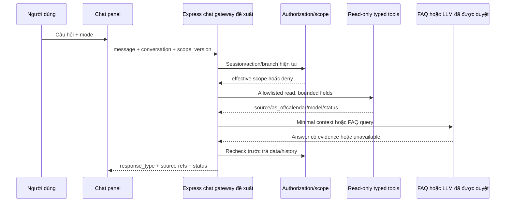

# UI0 — Chatbot thật, readiness và trust boundary
07/11/2026. **Kiến trúc đề xuất, không tích hợp LLM.** [Robot](ROBOT_AI_ASSISTANT_SPEC.md), [B0 API](RETAIL_INSIGHT_B0_API_CONTRACTS.md).

## Inventory/readiness từ source
| Khía cạnh | Bằng chứng | Trạng thái |
|---|---|---|
| Mounted assistant UI | App.jsx /assistant→ComingSoon, allow OWNER/ADMIN | PARTIAL placeholder, không chat |
| Legacy conversational UI | pages/AIAssistant.jsx demoAnswer và useState messages | MOCK/DEMO; không mounted; không tái dùng câu trả lời như data assistant |
| Forecast inference | backend business/ai.js aiCall→FastAPI /v1/operational,/multi,/sku,... | VERIFIED_IN_SOURCE đường gọi, readiness runtime UNKNOWN |
| Model/algorithm | Hybrid30features blend25/75, stockout7features/proxy threshold0.3299, replenishment/seasonal source | Không LLM/generative chat; models directory chỉ README, env MODEL_DIRECTORY không đọc nên actual availability UNKNOWN |
| KB/search/help | không curated KB/index/search API trong runtime | MISSING |
| Conversation storage | không bảng/API; legacy state mất khi rời page | MISSING |
| Auth | cookie JWT+auth_sessions, requireRoles+branch/dataset guards | Có source, phải reuse; per-chat tool authorization/action/scope chưa có |
| Logging/rate/quota | HTTP duration logs, auth limiter100/15min, AI timeout20s | PARTIAL; chat cost/token/concurrency quotas và audit/redaction thiếu |
| Inference cost/provider | chưa provider LLM/usage/pricing contract | UNKNOWN; không quote cost/package numbers, không gửi data ra ngoài |

FastAPI hiện model math không được đổi tên thành “chatbot backend hoàn chỉnh”. Forecast total operational trả MISSING_PREVIOUS_FORECAST_SNAPSHOT; multi cần12tháng, SKU cần6tháng và categorical attrs phù hợp. Replenishment dùng ceil(pred)+ceil(.2pred)−knownstock, không phải ceil(1.2pred) và thiếu stock không là0. UI help giải thích chính xác phiên bản thuật toán, không dựa formula demo cũ.

## Hai mode tách biệt
Support Assistant: FAQ/manual search deterministic, articleID/version/link, không business records. Có thể giao diện chat-like nhưng nhãn “Hướng dẫn từ tài liệu”, response_type=FAQ, không giả LLM. B0 chỉ thiết kế; FAQ corpus thực cũng cần review trước UI5.
Business Assistant: user request read-only explanations trong permitted tenant/branch; kết quả forecast/replenishment cómodel/calendar/as_of/input scope; numeric values lấy từ typed tool results, không hallucinated aggregate. Nếu AI unavailable hoặc cold-start, trả trạng thái thiếu và bước chuẩn bị dữ liệu; không inference giả.
Không có tool product.update/sale.create/import.commit/refund/price change. Link “Mở phiếu nhập” chỉ chuyển workspace đã được phép, draft do người dùng review; không tự post qua chat, kể cả OWNER nhắn “cứ làm đi”. Không gửi data business đến external provider trước approval.

Forecast payload không dùng research/archive làm fallback. Query/context từ file upload hoặc product note là untrusted text, không system instructions. Không SQL doLLM sinh, không DB creds trong prompt, chỉ tool ID+validated args. Prompt injection tests gồm fileheader “ignore tenant”, cross-branch conversation reuse, requested secret/tool write, forged article/source citations.

## Contract/vòng đời đề xuất
POST /api/v2/conversations {mode:HELP|BUSINESS,branch_id?}; user/org server-owned. POST /:id/messages {client_message_id,text,expected_scope_version}; max input đề xuất2000ký tự/response bounded, concurrency1active/conversation, per-org quota được duyệt. GET history reauthorize hiện tại; permission revoke hoặcbranchswitch →scope stale, không trả câu trả lời cũ thuộc branch mất quyền.
Response {message_id,status:ANSWERED|INSUFFICIENT_DATA|UNAVAILABLE|DENIED,response_type:FAQ|BUSINESS_EXPLANATION,answer,source_refs,as_of,calendar,model_version,correlation_id}. Không đưa score0 khinull. Serverstream chỉ nếu thực sựstream, reconnect theo cursor/message ID, không duplicate message/billing.
Conversation input lưu sau action authorization; lưu secret/PII-minimized, retention đề xuất90ngày cần duyệt; encrypted store ACL, reset scope UI clear context một cách rõ. Pending posted action không tồn tại vì chat chỉread; networktimeout không tạointent kinh tế mới.
Cost telemetry: provider/model, input/output units, latency,p95, quota exhaustion, daily budget, rejection không log raw payload. Chưa chọn provider/nơi lưu; cost UNKNOWN, approval riêng security/data-sharing/retention trước integration.
Human handoff: user consent chọn transcript/redacted correlation; support ticket không auto-attach customer sales. Nếu ticketAPI chưa có, chỉ “Chưa cấu hình hỗ trợ trực tuyến”, không fake “đã gửi”.

## UI và acceptance
Panel desktop400–440px, mobile full-width drawer; sidebar tabsFAQ/Business, sourcechips, messagecopy/feedback, retry chỉ message đọc cóidempotency; no forcing popups. FAQ cachedpublic docs cóversion, business không cache dữliệu tenant trongCDN/localStorage.
Gate UI5: actual FAQ docs/API, authenticated scoped read contract, no-mutation tests, adversarialinjection/revoke/tenantisolation, redacted logs, unavailable/error/streamcancel, offline/keyboard, quota/cost approval. Chưa đạt thì chỉ render accurate unavailable/help links, không dùng demoAnswer để fill khoảng trống.
