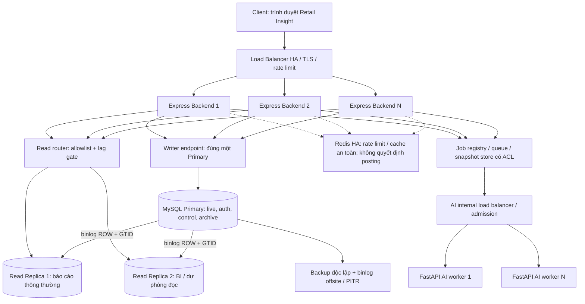

# Kế hoạch kỹ thuật P1.4 — Nền tảng ngày nghiệp vụ và archive lịch sử
Retail Insight — 06/11/2026. **THIẾT KẾ, CHƯA TRIỂN KHAI.**

Tài liệu tiếp nối [thiết kế P1.4](P1_4_BUSINESS_DATE_AND_HISTORY_DESIGN_2026-11-06.md) và [P1.3 đã triển khai](P1_3_BUSINESS_TIMEZONE_IMPLEMENTATION_2026-11-06.md). SQL dưới đây chỉ là DDL tham khảo trong tài liệu; không phải migration đã tạo, đã chạy hoặc đã kiểm thử.

## 1. Ranh giới hai giai đoạn

**A:** bổ sung ngày nghiệp vụ, metadata, policy/kỳ/audit/idempotency cho chứng từ vận hành; chuyển reader có kiểm soát. Writer vận hành chỉ tạo chứng từ của ngày hiện tại do server xác định. Không mở cửa sổ T−7/T−30; không cho hồi tố kho, kể cả OWNER.

**B:** staging và archive analytics-only tách vật lý khỏi stock_documents/items và inventory_movements/balances. Công bố lịch sử qua scope rõ ràng sau phê duyệt nguồn, preview và quyền. Import người dùng và publish archive đều mặc định tắt; việc có code/bảng không đồng nghĩa được nhận dữ liệu thật.

created_at tiếp tục UTC thật. business_date là DATE theo Asia/Ho_Chi_Minh, kèm snapshot timezone/policy/origin. Posted header/items bất biến; archive không tạo movement, không tăng/giảm tồn. Không thay calendar, query, weights hoặc pipeline AI. Không lấy dữ liệu nghiên cứu làm lịch sử kinh doanh.

Các quyền quản trị mới, bootstrap policy/kỳ, DDL, backfill, account DB phục vụ cutover và dữ liệu thật đều cần duyệt trước khi thực hiện.

## 2. Đối chiếu mã hiện tại và các điểm phải sửa trong tương lai

Đã đọc lại [migrations hiện có](../backend/src/db/migrations/002_operations.sql), [runner](../backend/src/db/migrate.js), [ledger](../backend/src/business/ledger.js), [AI](../backend/src/business/ai.js) và [cấu hình calendar](../backend/src/config/business-calendar.js).

| Hiện tại | Yêu cầu kỹ thuật khi triển khai |
|---|---|
| Runner split(';'), chỉ ghi schema_migrations sau toàn file | Không đưa trigger BEGIN/END hoặc backfill dài vào file rồi chạy runner cũ. Cần executor nhận từng statement hoàn chỉnh và checkpoint từng bước |
| Writer INSERT header total=0 rồi UPDATE total cuối transaction | Tính và khóa toàn bộ giá/dòng trước, INSERT header với total cuối cùng; sau đó mới bật bất biến header |
| UNIQUE(org,type,request_key), hash JSON payload đã sort items | Giữ nguyên hash/normalizer legacy; thêm request receipt phiên bản mới, không viết lại hash cũ |
| Reader P1.3 dựa d.created_at và bucket IANA | Chỉ cutover sang DATE sau backfill đầy đủ và đối chiếu; không dùng clipping TIMESTAMP cho DATE |
| AI query trực tiếp stock_documents/items/movements, nhóm UTC | Không thêm archive vào bảng/view mà AI đang đọc; không đổi tên bảng vận hành thành UNION view |
| Scope org từ session, branch assignment và EXISTS cùng item | Giữ nguyên trên mọi reader mới, kể cả count, MIN/MAX, pagination và archive |

Không SELECT database trong lượt lập kế hoạch này. Số liệu/schema thực tế ở báo cáo trước là ảnh chụp cũ, không dùng giả định “hiện vẫn rỗng” để bỏ kiểm tra trước migration. Không đọc secret. Không có Git repository ở cwd nên không có git diff để chứng minh thay đổi; chỉ tạo tài liệu mới bằng đường dẫn cụ thể.

## 3. Hợp đồng dữ liệu và kiểu chung

- organization_id, branch_id, user/product_id: INT UNSIGNED, đúng kiểu bảng hiện tại.
- ID chứng từ, batch, event, audit: BIGINT UNSIGNED; JSON API trả chuỗi cho ID vượt Number.MAX_SAFE_INTEGER, không làm tròn qua Number.
- business_date: DATE, không tự parse thành JavaScript Date. Validator ghi chấp nhận miền DATE và chính sách ngày; validator query Gregorian 0001–9999 vẫn giữ.
- Timestamp mới dùng DATETIME(6) với quy ước UTC; truyền UTC từ server/UTC_TIMESTAMP(6), không dùng DEFAULT CURRENT_TIMESTAMP cho DATETIME rồi giả định session ngoài ứng dụng cũng UTC. created_at cũ giữ nguyên kiểu TIMESTAMP(0).
- timezone VARCHAR(64), policy/schema/hash algorithm version tường minh. Không cho client tự chọn timezone tổ chức hoặc writer_epoch.
- Tiền DECIMAL(16,2), quantity INT dương; canonical hash dùng decimal string/cents chính xác. Không tăng precision/limit hoặc gộp dòng khác giá ngoài phê duyệt.
- Các bảng tenant có UNIQUE(organization_id,id); FK tài nguyên tenant luôn composite. Không CASCADE DELETE dữ liệu kinh tế/audit.
- Collation định danh nguồn phải được chốt. DDL minh họa dùng VARBINARY cho canonical external identity để không bị so sánh không phân biệt hoa/thường hoặc bỏ khoảng trắng.
- Không lưu file gốc hoặc PII trong audit JSON; chỉ reference được cấp quyền và checksum.

## 4. Giai đoạn A — DDL tham khảo

### A1. Expand header và control tables

~~~sql
ALTER TABLE stock_documents
  ADD COLUMN business_date DATE NULL,
  ADD COLUMN business_timezone VARCHAR(64) NULL,
  ADD COLUMN date_policy_version VARCHAR(40) NULL,
  ADD COLUMN business_date_origin VARCHAR(40) NULL,
  ADD COLUMN writer_epoch INT UNSIGNED NULL,
  ADD COLUMN posting_revision BIGINT UNSIGNED NULL;

CREATE TABLE business_schema_control (
  singleton_id TINYINT UNSIGNED NOT NULL PRIMARY KEY,
  mode VARCHAR(24) NOT NULL,
  required_writer_epoch INT UNSIGNED NOT NULL,
  reader_basis VARCHAR(24) NOT NULL,
  version BIGINT UNSIGNED NOT NULL,
  changed_at_utc DATETIME(6) NOT NULL,
  CHECK(singleton_id=1),
  CHECK(mode IN ('EXPAND','MAINTENANCE','ENFORCED')),
  CHECK(reader_basis IN ('RECORDED_TIME','BUSINESS_DATE'))
) ENGINE=InnoDB;

CREATE TABLE branch_posting_guards (
  organization_id INT UNSIGNED NOT NULL,
  branch_id INT UNSIGNED NOT NULL,
  live_revision BIGINT UNSIGNED NOT NULL DEFAULT 0,
  archive_revision BIGINT UNSIGNED NOT NULL DEFAULT 0,
  PRIMARY KEY(organization_id,branch_id),
  FOREIGN KEY(organization_id,branch_id)
    REFERENCES branches(organization_id,id)
) ENGINE=InnoDB;

CREATE TABLE business_posting_policies (
  id BIGINT UNSIGNED AUTO_INCREMENT PRIMARY KEY,
  organization_id INT UNSIGNED NOT NULL,
  branch_id INT UNSIGNED NOT NULL,
  policy_version BIGINT UNSIGNED NOT NULL,
  business_timezone VARCHAR(64) NOT NULL,
  live_date_mode VARCHAR(24) NOT NULL,
  archive_enabled BOOLEAN NOT NULL DEFAULT FALSE,
  combined_enabled BOOLEAN NOT NULL DEFAULT FALSE,
  effective_from_utc DATETIME(6) NOT NULL,
  created_by INT UNSIGNED NOT NULL,
  created_at_utc DATETIME(6) NOT NULL,
  UNIQUE KEY policy_tenant(organization_id,id),
  UNIQUE KEY policy_version_key(organization_id,branch_id,policy_version),
  FOREIGN KEY(organization_id,branch_id) REFERENCES branches(organization_id,id),
  FOREIGN KEY(organization_id,created_by) REFERENCES users(organization_id,id),
  CHECK(live_date_mode='TODAY_ONLY')
) ENGINE=InnoDB;

CREATE TABLE business_periods (
  id BIGINT UNSIGNED AUTO_INCREMENT PRIMARY KEY,
  organization_id INT UNSIGNED NOT NULL,
  branch_id INT UNSIGNED NOT NULL,
  date_start DATE NOT NULL,
  date_end_exclusive DATE NOT NULL,
  live_state VARCHAR(12) NOT NULL,
  archive_state VARCHAR(12) NOT NULL,
  version BIGINT UNSIGNED NOT NULL,
  policy_id BIGINT UNSIGNED NOT NULL,
  changed_by INT UNSIGNED NOT NULL,
  changed_at_utc DATETIME(6) NOT NULL,
  UNIQUE KEY period_tenant(organization_id,id),
  UNIQUE KEY period_start_key(organization_id,branch_id,date_start),
  FOREIGN KEY(organization_id,branch_id) REFERENCES branches(organization_id,id),
  FOREIGN KEY(organization_id,policy_id) REFERENCES business_posting_policies(organization_id,id),
  FOREIGN KEY(organization_id,changed_by) REFERENCES users(organization_id,id),
  CHECK(date_start < date_end_exclusive),
  CHECK(live_state IN ('OPEN','CLOSED')),
  CHECK(archive_state IN ('OPEN','CLOSED'))
) ENGINE=InnoDB;
~~~

Policy append-only; pointer tới policy đang có hiệu lực phải được resolve và kiểm version dưới branch guard. Không tự lấy “version lớn nhất” nếu effective_from còn trong tương lai. Có thể bổ sung active_policy_id vào guard ở DDL cuối để lookup và khóa đơn giản; FK phải cùng org/branch, không chỉ cùng org.

Kỳ là tháng địa phương; date_start phải đầu tháng, date_end_exclusive đúng đầu tháng sau. Service kiểm dưới guard để không có khoảng giao nhau; UNIQUE start đơn lẻ không bảo đảm điều này. Kỳ tháng 12/9999 không thể biểu diễn end=10000 trong DATE: phase đầu không tạo kỳ đó, trả lỗi domain rõ ràng; query read 9999 vẫn hợp lệ. Ngày hiện tại nằm trong miền TIMESTAMP đang vận hành; không mở lịch sử tùy ý vì validator đọc rộng.

Tách live_state/archive_state: đóng kỳ vận hành không tự cho phép publish archive vào cùng kỳ. Duyệt archive kỳ đã đóng phải có authorization/revision riêng; chưa triển khai reopen live. Chưa mở T−7/T−30 bằng một cột JSON mặc định.

### A2. Request receipt và audit

~~~sql
CREATE TABLE document_request_receipts (
  id BIGINT UNSIGNED AUTO_INCREMENT PRIMARY KEY,
  organization_id INT UNSIGNED NOT NULL,
  branch_id INT UNSIGNED NOT NULL,
  document_type VARCHAR(12) NOT NULL,
  request_key VARBINARY(80) NOT NULL,
  request_schema_version VARCHAR(32) NOT NULL,
  envelope_hash BINARY(32) NOT NULL,
  resolved_hash BINARY(32) NOT NULL,
  business_date DATE NOT NULL,
  policy_version BIGINT UNSIGNED NOT NULL,
  accepted_at_utc DATETIME(6) NOT NULL,
  document_id BIGINT UNSIGNED NOT NULL,
  response_version VARCHAR(24) NOT NULL,
  response_json JSON NOT NULL,
  UNIQUE KEY receipt_tenant(organization_id,id),
  UNIQUE KEY receipt_key(organization_id,document_type,request_key),
  UNIQUE KEY receipt_document(organization_id,document_id),
  FOREIGN KEY(organization_id,branch_id) REFERENCES branches(organization_id,id),
  FOREIGN KEY(organization_id,document_id) REFERENCES stock_documents(organization_id,id),
  CHECK(document_type IN ('SALE','RECEIPT'))
) ENGINE=InnoDB;

CREATE TABLE business_audit_events (
  id BIGINT UNSIGNED AUTO_INCREMENT PRIMARY KEY,
  organization_id INT UNSIGNED NOT NULL,
  branch_id INT UNSIGNED NOT NULL,
  actor_id INT UNSIGNED NOT NULL,
  action VARCHAR(64) NOT NULL,
  target_kind VARCHAR(32) NOT NULL,
  target_ref VARCHAR(100) NOT NULL,
  correlation_id CHAR(36) CHARACTER SET ascii COLLATE ascii_bin NOT NULL,
  occurred_at_utc DATETIME(6) NOT NULL,
  policy_version BIGINT UNSIGNED NULL,
  data_revision BIGINT UNSIGNED NULL,
  reason VARCHAR(1000) NULL,
  metadata JSON NOT NULL,
  UNIQUE KEY audit_tenant(organization_id,id),
  KEY audit_scope(organization_id,branch_id,id),
  FOREIGN KEY(organization_id,branch_id) REFERENCES branches(organization_id,id),
  FOREIGN KEY(organization_id,actor_id) REFERENCES users(organization_id,id)
) ENGINE=InnoDB;
~~~

Request receipt tạo cùng transaction đã tạo document; không dùng schema này làm hàng PENDING có document_id giả. Tranh chấp key được giải quyết bằng unique constraint và retry lookup sau rollback. Lookup cũ vẫn theo collation/key semantics cũ; key mới phải chống xung đột với UNIQUE document_request hiện hữu. Không tự đổi collation constraint cũ. DDL receipt cuối phải dùng key comparison tương thích constraint cũ hoặc chuẩn hóa key mới về alphabet ASCII phân biệt rõ theo contract; test cùng key khác case để tránh hai bộ UNIQUE hiểu khác nhau. Quyết định khuyến nghị: giữ so sánh request_key theo cột stock_documents thực tế, natural source identity mới dùng binary riêng.

Audit thành công cùng transaction dữ liệu. Denied/rollback audit qua luồng ghi riêng sau rollback; lỗi ghi audit failure cần operational alert, không phản hồi “đã ghi audit” khi chưa ghi. actor_id của audit thao tác là user thật; sự kiện migration dùng principal vận hành/manifest riêng được thiết kế trước, không giả OWNER hoặc tạo user ẩn. Audit system không có actor user cần cột actor_kind + actor_user_id nullable + actor_service_ref và CHECK loại tương ứng trong DDL cuối; bảng minh họa trên dành cho hành động user.

### A3. Index và contract sau backfill

Chọn một index đầu tiên sau EXPLAIN: (organization_id,business_date,branch_id,id) cho all-branch hoặc (organization_id,branch_id,business_date,id) cho branch chính. Không tự tạo cả hai. Giữ document_period(created_at) cho audit và AI.

Sau đối chiếu, chuyển các cột business_date/timezone/policy/origin/epoch/revision sang NOT NULL **không default ngầm**. CHECK origin chỉ nhận SERVER_TODAY hoặc DERIVED_FROM_RECORDED_AT ở A; EXTERNAL_VERIFIED chỉ nằm archive B. CHECK không đủ để chứng minh today/policy/actor đúng: writer trusted kiểm trong transaction, trigger fence bổ trợ. Không thêm cột business_date vào movement để tránh hai nguồn ngày lệch nhau.

## 5. A — Writer, ngày mặc định và idempotency

Thứ tự mới trong transaction:
1. Auth/tenant/role; xác minh branch ACTIVE và assignment. Lookup replay đã commit theo key sau kiểm quyền truy cập hiện tại.
2. Khóa branch guard; đọc schema epoch, policy và kỳ; recheck role/assignment dưới lock theo chiến lược thống nhất. Thiếu guard/policy/kỳ phải fail closed, không ngầm tạo OPEN.
3. Lấy accepted_at UTC tin cậy sau khi chờ lock; tính business_today bằng IANA một lần. Clock dùng cùng instant cho created_at mới (ghi UTC thực tại điểm chấp nhận) và business_date. Nếu chọn giữ DB default created_at thì phải có cơ chế bảo đảm ngày của timestamp thực tế khớp; không để hai clock hai phía nửa đêm. Khuyến nghị bind cùng accepted_at UTC đến giây theo precision TIMESTAMP(0), lưu instant chính xác hơn trong receipt.
4. Body cũ bỏ ngày: default today. Body mới nếu gửi ngày khác today bị từ chối; không mở ngoại lệ OWNER. Không nhận created_at/actor/epoch từ client.
5. Khóa product/balance theo product_id tăng dần, lấy giá server cho SALE, kiểm quantity/tồn/total. Chuẩn bị toàn bộ dòng và total trước INSERT header.
6. INSERT header tổng cuối, items, delta movements, UPDATE current balance, tăng branch live_revision, INSERT receipt và audit cùng transaction. Bất kỳ lỗi rollback hết.
7. COMMIT; response 201. Replay trả 200 + replayed:true, không áp delta hoặc ghi posted event lần nữa.

Giữ giá receipt và giá SALE hiện tại đúng contract cũ. Bất biến header sau INSERT yêu cầu bỏ UPDATE total cuối writer cũ trước khi bật trigger. Item/movement chỉ INSERT trong transaction mới, không UPDATE/DELETE posted. DB triggers có thể cấm sửa/xóa dòng hiện có; việc INSERT thêm item vào header đã commit cần guard bổ sung: writer mới gắn receipt/finalization marker cuối transaction; trigger item/movement từ chối append khi marker tồn tại. Trước cutover tạo marker cho legacy. Account ứng dụng không được xóa marker. Test crash trước marker bảo đảm toàn transaction rollback; không chấp nhận commit từng phần. Nếu muốn chống cả một client DB có quyền INSERT cố tình commit header thiếu marker, cần stored posting procedure và thu hồi direct DML; đây là mức hardening riêng cần duyệt, không tuyên bố trigger đơn lẻ chứng minh mọi commit hợp lệ.

**Hai hash:** envelope_hash = nội dung client canonical, không default ngày/giá mới mỗi lần; resolved_hash = envelope + date/timezone + giá đã khóa + policy + schema. Omitted-date khác explicit-date ở envelope phải có quy tắc rõ, khuyến nghị coi khác payload thay vì đoán ý.

- Replay đã commit: so envelope theo version đã ghi; trả dữ liệu frozen sau auth/scope, kể cả ngày đã sang hôm sau hoặc kỳ/policy vừa đổi. Kỳ đóng không làm retry tạo bản mới.
- Chưa commit/rollback hoàn toàn: chưa có receipt frozen; lần mới được kiểm today/policy hiện tại. Không hứa giữ ngày của một request thất bại trước commit.
- Hai request cùng key chờ guard: request sau lookup lại dưới lock; duplicate race unique rollback rồi đọc committed result.
- Legacy: dùng normalizer/hash hiện hữu, không dựng request cũ từ giá catalog hiện tại; không bịa accepted_at hoặc resolved_hash cho lịch sử thiếu request envelope. Có thể giữ lookup legacy riêng thay vì backfill receipt giả.
- Timeout sau COMMIT: client tra cùng key; không cấp key mới rồi ghi lại. Retry deadlock có giới hạn và cùng envelope/key.

## 6. A — Kỳ, policy, quyền và fence writer cũ

### Quyền đề xuất, chưa được cấp

| Hành động | OWNER | MANAGER | CASHIER | INVENTORY |
|---|---|---|---|---|
| SALE today | Trong org | Branch được gán | Branch được gán | Không |
| RECEIPT today | Trong org | Branch được gán | Không | Branch được gán |
| Hồi tố live | Không trong A/B | Không | Không | Không |
| Xem policy phục vụ form | Scope được phép | Scope được phép | Scope SALE | Scope RECEIPT |
| Close live period/cấu hình policy | Cần duyệt chức năng riêng | Không mặc định | Không | Không |
| Quản trị archive | Theo quyền B được phê duyệt | Chỉ draft/preview nếu được duyệt | Không mặc định | Không mặc định |

Missing kỳ chặn ghi mới nhưng không chặn trả replay đã commit. Kỳ OPEN cho ngày hiện tại phải được bootstrap/rollover có kiểm soát trước activation; chưa duyệt close UI không có nghĩa tự đóng kỳ cuối tháng. Writer không tự mở kỳ. Rollover tháng cần operator setup trước hoặc job có policy được duyệt; monitor cảnh báo trước tháng mới.

Khóa guard → policy/period → product/balance theo ID → request/registry theo thứ tự ổn định. Close/policy activation và mọi writer dùng cùng guard; giữ transaction ngắn, không gọi mạng/OCR trong lock. FOR UPDATE chỉ bảo vệ đúng khi cùng transaction; xem [MySQL locking reads](https://dev.mysql.com/doc/refman/9.7/en/innodb-locking-reads.html).

### Cutover không chỉ dựa feature flag

1. Bật maintenance tại ingress cho API ghi; dừng queue/CLI writer đã xác minh. Giữ GET cần thiết. Inventory mọi instance, PID/job và DB principal; chờ transaction cũ drain rồi kiểm lại.
2. Deploy writer epoch mới nhưng chưa cho traffic; cài schema/trigger fence trong maintenance. Trigger INSERT stock_documents từ chối metadata NULL/zero-date, epoch khác required và mode MAINTENANCE. Không dùng session variable do client tự đặt làm bảo mật.
3. Tạo marker legacy, contract NOT NULL, bật trigger bất biến đúng thứ tự. Trigger không được chặn phép backfill đã duyệt trước khi backfill xong.
4. Khuyến nghị dùng DB principal runtime epoch mới, quyền tối thiểu; thu hồi quyền ghi và đóng kết nối của principal cũ sau xác minh. Không tự sửa password/token trong task kế hoạch. Chỉ env flag hoặc NOT NULL không đủ bảo đảm chặn mọi client SQL cũ.
5. Chứng minh binary cũ chạy POST thật trên disposable bị từ chối tại INSERT header, transaction không đổi inventory/items/movements. Source hiện tại INSERT doc trước delta nên fence này phù hợp đường ghi cũ đã đọc. Không suy rộng thành chống mọi script DB có quyền rộng.
6. Kiểm health schema epoch/version, mở read basis v2 rồi traffic ghi epoch mới. Instance không tương thích fail startup/readiness; không silently fallback writer cũ.
7. Nếu không có khả năng drain/fence/thu hồi writer cũ: **NO-GO**, không backfill cuối hoặc cutover.

Trigger nhiều statement cần executor giữ nguyên CREATE TRIGGER ... BEGIN ... END; DELIMITER là lệnh client, không gửi vào mysql2. Runner hiện tại split(';') phải được nâng cấp có test trước. [MySQL trigger syntax](https://dev.mysql.com/doc/refman/9.7/en/trigger-syntax.html).

## 7. A — Runbook migration/backfill và recovery

| Bước | Hành động sau phê duyệt | Điều kiện chuyển bước |
|---|---|---|
| A0 | Inventory schema, sql_mode, grants, timezone session, indexes, runner; backup/restore drill được phép | Xác nhận đúng DB, manifest schema/version và nơi backup an toàn |
| A1 | Thử toàn bộ migration trên MySQL disposable cùng phiên bản/collation | Trigger, precision, locks, quyền và failure injection đạt |
| A2 | Expand nullable/control tables bằng statement có checkpoint | Không thay field cũ/timestamps; runner ghi checksum/status từng step |
| A3 | Deploy code tương thích expand, chưa đổi reader hoặc bật import | Writer mới dual-populate; binary cũ còn có thể tạo NULL nên chưa contract |
| A4 | Backfill sơ bộ theo PK có high-watermark/chunk và conditional NULL update | Đối chiếu từng chunk; dừng/resume không sửa row đã xác nhận |
| A5 | Maintenance/drain/fence; final tail backfill; bootstrap policy/guards/kỳ có phê duyệt | Không writer cũ hoạt động; không NULL; đủ marker/coverage |
| A6 | Contract constraints, trigger, index đã benchmark | Không missing provenance; mọi invariant và replay legacy đạt |
| A7 | Read-only parity P1.3/v2, activate reader v2, thử writer mới bằng môi trường đã duyệt | Không thử bằng giao dịch thật nếu chưa được cấp phép |
| A8 | Mở traffic; monitor error/conflict/latency; import vẫn OFF | Release sign-off; báo cáo DDL/backfill/totals riêng |

Backfill business_date = IANA date(created_at UTC), timezone snapshot và origin DERIVED_FROM_RECORDED_AT. Node Temporal pinned hiện có; không named CONVERT_TZ, không fixed+7 cho 1970. Date không đổi created_at hoặc hash legacy. Manifest lưu min/max ID, row counts, UTC timestamp checksum trước/sau, tổng tiền/quantity và timezone/library/policy version. Payload kinh tế/timestamps phải giữ nguyên. Null created_at bất thường: quarantine và NO-GO cho row đó, không đoán ngày.

Không cần backfill inventory quantities/movement dates. Đọc ngày movement qua doc.business_date; audit m.created_at nguyên trạng. Migration nhiều chunk có checkpoint và lần cuối dưới fence; không giả snapshot liên tục nếu vẫn có writer cũ.

DDL MySQL có implicit commit; atomic một ALTER không phải transaction rollback cho cả chuỗi DDL/backfill. Xem [MySQL implicit commit](https://dev.mysql.com/doc/refman/9.7/en/implicit-commit.html).

**Recovery:**
- Trước reader v2/ghi mới: pause, tiếp tục reader recorded-time, giữ cột nullable và dữ liệu expand; resume step từ checksum/checkpoint sau kiểm tra. Không tự DROP.
- DDL lỗi giữa chừng: inspect information_schema/trigger definition, so manifest; forward-fix đúng step. Không đánh dấu toàn migration applied vì một vài ALTER thành công.
- Sau reader v2 nhưng trước lịch sử: có thể trả reader P1.3 theo flag trong maintenance sau parity; writer phải vẫn epoch mới và giữ metadata/audit. Không rollback binary writer cũ.
- Sau có chứng từ mới/audit: giữ dữ liệu, sửa tiến bằng code/schema tương thích. Không xóa doc/receipt để retry. Business date sai đã posted: khóa phạm vi, báo incident, chờ workflow sửa được duyệt.
- Restore backup toàn DB chỉ trong runbook khôi phục thảm họa được duyệt, xác định RPO/RTO và giao dịch mới sau backup; không coi restore là nút rollback mặc định.

## 8. A — Tương thích API/BI và P1.3

Sau cutover:
- GET sales/receipts/count và BI dùng d.business_date >= ? và <= ?, giữ DATE index, không bọc cột trong hàm ở WHERE.
- start/end vẫn là chuỗi Gregorian, end-inclusive. Cận 0001 là cận dư thấp hơn miền DATE, cận 9999 hợp lệ; khoảng không giao miền trả rỗng có scope. Không dùng helper clipping TIMESTAMP 1970–2038.
- Group ngày từ DATE; tháng DATE_FORMAT(business_date,'%Y-%m') hợp lệ vì DATE đã là ngày nghiệp vụ, không cần timezone tables/bucket instant. Auth và timestamps vẫn UTC.
- Movement list/chart dùng ngày doc; trả cả business_date và raw document_created_at/movement.created_at để audit. Inventory hiện tại không bị lọc hồi tố.
- Giữ EXISTS category/product cùng item, tenant/branch scope và count/list chung predicates. BI cộng dòng phù hợp, list trả tổng toàn chứng từ như P1.2.
- Legacy backfill từ recorded-time IANA phải cho tập doc/KPI/trend khớp P1.3 trước khi có ngày nguồn mới. Chênh lệch là NO-GO.
- Thứ tự list hiện id DESC giữ để tương thích; chưa đổi sang business_date DESC. Nếu muốn đổi thứ tự cần version/duyệt riêng.
- API chi tiết thêm field, không xóa created_at. Policy endpoint cung cấp business_today/allowed_actions/version từ server.
- Metadata date_source=stock_documents.business_date, policy_version=business-date-v2; timestamp_basis=UTC. Không gắn start_utc/end_utc_exclusive như predicate thật của DATE. Hỗ trợ metadata v1 nếu cần client chuyển tiếp, có thời hạn rõ.
- Frontend giữ formatter IANA P1.3, thêm “Ngày phát sinh” và “Ghi nhận hệ thống”; ngày DATE in nguyên, không đưa qua Date. Form không cho hồi tố A.
- Cache/bookmark/export key phải gồm basis/version/scope. Không tạo chức năng export/cache mới ngoài phạm vi.

Không sửa AI sang business_date trong A. Vì A chỉ today và không có hồi tố vận hành, không tạo đường mới nhận lịch sử trễ vào stock_documents. AI vẫn calendar cũ được công bố; việc tính created_at từ cùng accepted instant phải giữ thời điểm thực, không chuyển giờ giả để khớp BI.

## 9. Giai đoạn B — Mô hình staging/archive và định danh

DDL sau là phần cốt lõi đề nghị review, chưa hoàn chỉnh cho release. Các cột trạng thái/version/timestamp/source phải được rà soát CHECK/FK và migration ordering trên disposable.

### B1. Nguồn, batch và mapping bất biến theo version

~~~sql
CREATE TABLE history_sources (
  id BIGINT UNSIGNED AUTO_INCREMENT PRIMARY KEY,
  organization_id INT UNSIGNED NOT NULL,
  namespace VARBINARY(120) NOT NULL,
  name VARCHAR(180) NOT NULL,
  identity_contract_version VARCHAR(32) NOT NULL,
  status VARCHAR(12) NOT NULL,
  created_by INT UNSIGNED NOT NULL,
  created_at_utc DATETIME(6) NOT NULL,
  UNIQUE KEY source_tenant(organization_id,id),
  UNIQUE KEY source_namespace(organization_id,namespace),
  FOREIGN KEY(organization_id) REFERENCES organizations(id),
  FOREIGN KEY(organization_id,created_by) REFERENCES users(organization_id,id),
  CHECK(status IN ('ACTIVE','SUSPENDED'))
) ENGINE=InnoDB;

CREATE TABLE history_import_batches (
  id BIGINT UNSIGNED AUTO_INCREMENT PRIMARY KEY,
  organization_id INT UNSIGNED NOT NULL,
  branch_id INT UNSIGNED NOT NULL,
  source_id BIGINT UNSIGNED NOT NULL,
  request_key VARBINARY(80) NOT NULL,
  upload_hash BINARY(32) NOT NULL,
  request_hash BINARY(32) NOT NULL,
  storage_ref VARCHAR(255) NOT NULL,
  parser_version VARCHAR(32) NOT NULL,
  mapping_version BIGINT UNSIGNED NOT NULL,
  version BIGINT UNSIGNED NOT NULL,
  state VARCHAR(24) NOT NULL,
  uploaded_by INT UNSIGNED NOT NULL,
  created_at_utc DATETIME(6) NOT NULL,
  UNIQUE KEY batch_tenant(organization_id,id),
  UNIQUE KEY batch_request(organization_id,request_key),
  FOREIGN KEY(organization_id,branch_id) REFERENCES branches(organization_id,id),
  FOREIGN KEY(organization_id,source_id) REFERENCES history_sources(organization_id,id),
  FOREIGN KEY(organization_id,uploaded_by) REFERENCES users(organization_id,id),
  CHECK(state IN ('UPLOADED','PARSED','INVALID','READY','SUBMITTED',
                 'APPROVED','COMMITTED','REJECTED','CANCELLED'))
) ENGINE=InnoDB;

CREATE TABLE history_mapping_versions (
  id BIGINT UNSIGNED AUTO_INCREMENT PRIMARY KEY,
  organization_id INT UNSIGNED NOT NULL,
  source_id BIGINT UNSIGNED NOT NULL,
  version BIGINT UNSIGNED NOT NULL,
  mapping_hash BINARY(32) NOT NULL,
  mapping_json JSON NOT NULL,
  created_by INT UNSIGNED NOT NULL,
  created_at_utc DATETIME(6) NOT NULL,
  UNIQUE KEY mapping_tenant(organization_id,id),
  UNIQUE KEY mapping_version_key(organization_id,source_id,version),
  FOREIGN KEY(organization_id,source_id) REFERENCES history_sources(organization_id,id),
  FOREIGN KEY(organization_id,created_by) REFERENCES users(organization_id,id)
) ENGINE=InnoDB;
~~~

mapping_json là snapshot parser date format, source timezone, branch/SKU mapping và format tiền; JSON không thay kiểm FK tenant khi materialize dòng staging. Muốn DB enforce mapping target, thêm history_mapping_products(org,mapping_id,source_product_ref,product_id) và history_mapping_branches tương tự với composite FK. Không nhận SQL/biểu thức code do user cung cấp.

Bổ sung FK batch→mapping qua khóa có source/version tương ứng sau khi bảng mapping được tạo, hoặc tạo mapping trước batch ở migration thật. Không chỉ kiểm cùng org rồi cho batch dùng mapping của source khác.

### B2. Staging rows, documents, preview, approval

| Bảng dự kiến | Cột/constraint chính |
|---|---|
| history_staging_rows | id/org/batch_id, row_number UNIQUE(batch,row), raw reference/hash, normalized JSON, validation codes; FK(org,batch). Raw file ở storage riêng, row JSON đã giảm PII |
| history_staging_documents | id/org/batch, source_external_id binary, type, business_date, timezone/policy/origin, nullable source_occurred_at_utc, precision, totals, canonical_hash, state/version; UNIQUE(batch,type,external_id) |
| history_staging_items | org/staging_document_id,line_number,product_id,source_line_ref,quantity,unit_price,sku/name snapshot; UNIQUE(document,line_number), FK org/product, quantity>0 price>=0 |
| history_previews | id/org/batch, batch_version, mapping/parser/policy versions, content_hash, ledger/archive revision, totals/counts, duplicate/conflict results, expires_at_utc, created_by; immutable |
| history_approvals | id/org/batch/preview_id, preview_hash, mode=ANALYTICS_ONLY, source/range scope, approver, reason, expiry, approval policy/version, status; không chỉ boolean approved |
| history_archive_authorizations | org/branch/period/batch/preview, allowed range DATE, expiry UTC, authorizer và revision; chỉ cần khi publish vào kỳ archive đã đóng được duyệt |

FK tất cả bảng staging/preview/approval có org; quan hệ batch+preview phải chứng minh đúng batch, không chỉ cùng org. DDL cuối thêm UNIQUE(org,batch_id,id) tại preview để FK approval(org,batch_id,preview_id). Batch state và optimistic version được update có điều kiện; posted archive không dùng staging state để quyết định tồn tại trong BI.

Phase đầu chỉ hỗ trợ source SALE/RECEIPT dương, không returns/cancel/draft, không VAT/discount thiếu contract, một product/doc. Dù archive có line_number, duplicate SKU khác giá phải reject cho đến khi semantics được duyệt; không gộp giá tùy ý. Giữ limits item100/quantity100000/DECIMAL hiện tại. Hạn mức file/batch chưa chốt; parser phải reject toàn gói vượt hạn, không cắt dòng.

### B3. Canonical event và source identity

~~~sql
CREATE TABLE business_event_registry (
  id BIGINT UNSIGNED AUTO_INCREMENT PRIMARY KEY,
  organization_id INT UNSIGNED NOT NULL,
  representation VARCHAR(12) NOT NULL,
  canonical_hash BINARY(32) NOT NULL,
  identity_version VARCHAR(32) NOT NULL,
  created_at_utc DATETIME(6) NOT NULL,
  UNIQUE KEY event_tenant(organization_id,id),
  FOREIGN KEY(organization_id) REFERENCES organizations(id),
  CHECK(representation IN ('LIVE','ARCHIVE'))
) ENGINE=InnoDB;

CREATE TABLE source_document_registry (
  id BIGINT UNSIGNED AUTO_INCREMENT PRIMARY KEY,
  organization_id INT UNSIGNED NOT NULL,
  source_id BIGINT UNSIGNED NOT NULL,
  document_type VARCHAR(12) NOT NULL,
  external_document_id VARBINARY(240) NOT NULL,
  event_id BIGINT UNSIGNED NOT NULL,
  source_payload_hash BINARY(32) NOT NULL,
  UNIQUE KEY source_document_tenant(organization_id,id),
  UNIQUE KEY natural_identity(
    organization_id,source_id,document_type,external_document_id),
  FOREIGN KEY(organization_id,source_id) REFERENCES history_sources(organization_id,id),
  FOREIGN KEY(organization_id,event_id) REFERENCES business_event_registry(organization_id,id),
  CHECK(document_type IN ('SALE','RECEIPT'))
) ENGINE=InnoDB;
~~~

Một canonical event có thể có nhiều source aliases, nhưng chỉ một representation được công bố. Hash file không thay natural identity. Registry lưu identity nguyên bản hoặc canonical theo contract nguồn; digest chỉ là index phụ, collision phải so full identity.

Bổ sung liên kết target:
- stock_documents.canonical_event_id nullable khi expand B; backfill một event LIVE cho từng doc và writer mới cấp event cùng transaction; UNIQUE(org,canonical_event_id), FK(org,event). Trước combined, yêu cầu coverage đầy đủ.
- historical_documents.canonical_event_id bắt buộc, UNIQUE(org,event).
- Quy tắc không cùng event ở cả hai bảng phải được enforce bởi trigger/transaction trên registry row đã khóa, vì hai UNIQUE riêng không bảo vệ xuyên bảng. Triggers kiểm representation đúng và cấm đổi representation khi đã published; service không được tự promote archive→live.
- Một registry row chưa có target trong lúc transaction đang xây không được commit riêng. Atomic publisher cùng event/target/source link/commit marker. Đối chiếu orphan thường xuyên; hardening stored procedure tùy mức threat được duyệt.
- Liên kết một nguồn mới vào LIVE event đã có cần đối chiếu nội dung/ngày/giá và xác nhận hợp lệ; không UPDATE legacy business_date để làm khớp nguồn. Nếu khác: conflict, chưa publish.
- Live doc không có sourceID chưa thể tự chứng minh không trùng hóa đơn upload. Không dedup theo cùng số tiền/ngày/SKU. Phải khai báo vùng cutover không chồng lấn có bằng chứng hoặc mapping verified source→live ID; overlap không giải quyết được thì chặn publish/combined.

Canonical hash của event LIVE được version hóa từ snapshot document/items tại thời điểm đăng ký, không thay payload_hash legacy. Hash nội dung nguồn có thể khác do raw metadata; cần semantic comparison có schema, không coi hai hash khác luôn là hai sự kiện kinh tế.

### B4. Archive header/items và commit receipt

~~~sql
CREATE TABLE historical_documents (
  id BIGINT UNSIGNED AUTO_INCREMENT PRIMARY KEY,
  organization_id INT UNSIGNED NOT NULL,
  branch_id INT UNSIGNED NOT NULL,
  batch_id BIGINT UNSIGNED NOT NULL,
  canonical_event_id BIGINT UNSIGNED NOT NULL,
  type VARCHAR(12) NOT NULL,
  business_date DATE NOT NULL,
  business_timezone VARCHAR(64) NOT NULL,
  date_policy_version VARCHAR(40) NOT NULL,
  business_date_origin VARCHAR(40) NOT NULL,
  source_occurred_at_utc DATETIME(6) NULL,
  source_precision VARCHAR(12) NOT NULL,
  total DECIMAL(16,2) NOT NULL,
  published_revision BIGINT UNSIGNED NOT NULL,
  created_at_utc DATETIME(6) NOT NULL,
  UNIQUE KEY history_tenant(organization_id,id),
  UNIQUE KEY history_event(organization_id,canonical_event_id),
  KEY history_period(organization_id,business_date,branch_id,id),
  FOREIGN KEY(organization_id,branch_id) REFERENCES branches(organization_id,id),
  FOREIGN KEY(organization_id,batch_id) REFERENCES history_import_batches(organization_id,id),
  FOREIGN KEY(organization_id,canonical_event_id) REFERENCES business_event_registry(organization_id,id),
  CHECK(type IN ('SALE','RECEIPT')),
  CHECK(total>=0),
  CHECK(business_date_origin='EXTERNAL_VERIFIED'),
  CHECK(source_precision IN ('DATE','INSTANT')),
  CHECK((source_precision='DATE' AND source_occurred_at_utc IS NULL)
     OR (source_precision='INSTANT' AND source_occurred_at_utc IS NOT NULL))
) ENGINE=InnoDB;

CREATE TABLE historical_document_items (
  id BIGINT UNSIGNED AUTO_INCREMENT PRIMARY KEY,
  organization_id INT UNSIGNED NOT NULL,
  document_id BIGINT UNSIGNED NOT NULL,
  product_id INT UNSIGNED NOT NULL,
  line_number INT UNSIGNED NOT NULL,
  sku VARCHAR(100) NOT NULL,
  product_name VARCHAR(180) NOT NULL,
  quantity INT NOT NULL,
  unit_price DECIMAL(16,2) NOT NULL,
  UNIQUE KEY history_line(document_id,line_number),
  UNIQUE KEY history_product(document_id,product_id),
  FOREIGN KEY(organization_id,document_id) REFERENCES historical_documents(organization_id,id),
  FOREIGN KEY(organization_id,product_id) REFERENCES products(organization_id,id),
  CHECK(quantity>0),
  CHECK(unit_price>=0)
) ENGINE=InnoDB;

CREATE TABLE history_commit_receipts (
  id BIGINT UNSIGNED AUTO_INCREMENT PRIMARY KEY,
  organization_id INT UNSIGNED NOT NULL,
  batch_id BIGINT UNSIGNED NOT NULL,
  preview_id BIGINT UNSIGNED NOT NULL,
  request_key VARBINARY(80) NOT NULL,
  request_hash BINARY(32) NOT NULL,
  committed_by INT UNSIGNED NOT NULL,
  committed_at_utc DATETIME(6) NOT NULL,
  result_json JSON NOT NULL,
  UNIQUE KEY commit_request(organization_id,request_key),
  UNIQUE KEY commit_batch(organization_id,batch_id),
  FOREIGN KEY(organization_id,batch_id) REFERENCES history_import_batches(organization_id,id),
  FOREIGN KEY(organization_id,committed_by) REFERENCES users(organization_id,id)
) ENGINE=InnoDB;
~~~

DDL cuối thêm FK composite preview/batch như B2; batch/branch consistency có thể thêm UNIQUE(org,branch,id) và FK ba cột. Mọi CHECK, FK name, key length và collation phải kiểm native trước phát hành. Không đưa các đoạn tham khảo còn thiếu bước hoàn thiện này vào runner thật.

created_at_utc của archive là mốc publish thật, không phải ngày nguồn. Optional source_recorded_at/raw offset lưu provenance riêng. Không có balance_after hoặc quantity_delta; không tồn tại đường gọi postDocument từ archive publisher.

## 10. B — Workflow, endpoints và transaction

Endpoint đề xuất, chưa tạo:
- GET /history/capabilities: flags, role actions, policy, source và range được phép.
- POST /history-imports: upload riêng có quota, request_key/hash; file quarantine không thực thi macro/formula.
- PUT /history-imports/:id/mapping: version + If-Match, tạo mapping version mới, invalidate preview/approval cũ.
- POST /:id/preview và GET /:id: parse/validate, không viết ledger/archive.
- POST /:id/submit, POST /:id/approve hoặc reject: scope và preview hash chính xác.
- POST /:id/commit: request_key + preview/approval version; không nhận flag stock_effect, actor/org tùy ý.
- GET /history/documents, /:id và audit: chỉ scope được phép; không tái dùng route chi tiết live với ID số mơ hồ.

**Upload:** MIME/size/content/parser whitelist, virus scan nếu có hạ tầng, SHA256 server tính; storage theo tenant ACL, không public path. File hash giống có thể trả batch cũ theo contract request, nhưng file khác mapping/parser không mặc định cùng preview. Scan/parse worker chỉ cập nhật staging, không có quyền publish. Job retry idempotent theo batch+parser+mapping version.

**Nguồn:** xác nhận ownership; source namespace và branch/SKU mapping do server registry. Không auto tạo product/branch/user. Ngày-only giữ DATE; Excel serial phải chọn 1900/1904, reject 1900-02-29; không đoán dd/mm. Timestamp nguồn cần timezone/offset và khớp business_date IANA. Giá nguồn snapshot được reconcile; dữ liệu nghiên cứu không nằm whitelist.

**Preview:** immutable hash gồm rows/doc totals, source/natural IDs, range, mapping/parser/policy, expected revisions, danh sách duplicates/conflicts và approval expiry. Không giữ DB lock lúc operator xem. Thay dữ liệu, source status, mapping hoặc quyền → preview stale; phải xem và duyệt lại.

**Approve:** OWNER trong org và branch hợp lệ; MANAGER chỉ chuẩn bị/submit nếu quyền này được phê duyệt. User đã upload có được tự approve không là quyết định còn mở; không mặc định hai người nếu cửa hàng một OWNER. Approval có mode ANALYTICS_ONLY và exact preview/range/source; không phải quyền mở live period.

**Commit nguyên tử một batch/một branch:**
1. Kiểm auth, permission, source ACTIVE, branch, flags. Nếu receipt đã commit: so request hash/version, kiểm quyền xem hiện tại, trả kết quả frozen; không đòi approval còn hạn để ghi lại vì không ghi.
2. Khóa branch guard, batch/approval/period và source identities theo thứ tự ổn định; lookup lại receipt. Kiểm preview hash/version/revision/expiry, quyền và kỳ archive/grant hiện tại.
3. Kiểm từng identity: NEW → event ARCHIVE + source link + doc/items; SAME → reference existing, không INSERT lại; CONFLICT → rollback batch và 409. Request không có externalID đáng tin phải staging/reject theo policy, không tạo ID từ số dòng để né chống trùng.
4. Total nguồn phải reconcile new/existing/conflict rõ. Chỉ NEW cộng thêm KPI. Batch toàn duplicate vẫn ghi receipt/audit kết quả không có doc mới; không báo imported_count bằng số dòng upload.
5. Tăng archive_revision nếu có publish mới; audit, batch COMMITTED, commit receipt cùng transaction. Không sửa live_revision hoặc inventory.
6. COMMIT; mất response tra bằng key/batch. ER_DUP_ENTRY từ race không auto đánh duplicate thành công: rollback, đọc và so canonical payload rồi quyết định replay/conflict.

Native row lock và UNIQUE là trọng tài; SELECT trước không đủ. Chia batch lớn thành sub-batch manifest chỉ sau duyệt riêng; không quảng cáo atomic file nếu nhiều transaction. Không DELETE phần đã commit để giả rollback. Tạm thời chỉ nhỏ/một branch; hạn mức số doc/line/bytes cần benchmark và duyệt.

**Tách quyền DB đề xuất:** parser chỉ staging; publisher chỉ archive/registry/receipt/audit + SELECT nguồn cần thiết, không DML stock_documents/items/inventory_movements/balances. Service runtime live không được gọi publisher bằng body mode. Cấp account/grants mới cần phê duyệt vận hành; nếu chưa tách account phải công bố giới hạn và test denylist SQL, không coi đó là tương đương rào quyền DB.

## 11. B — BI riêng/combined và cách ly AI/kho

### Scope và chống đếm đôi

Default /bi/overview giữ OPERATIONAL. HISTORY và COMBINED là opt-in sau approval, không tự xuất hiện vì archive có dữ liệu.

- Hai nguồn chuẩn hóa cùng shape: canonical_event_id, branch, type, business_date, items/snapshot prices. UNION ALL có tag LIVE/ARCHIVE, sau ràng buộc một event một representation; không dùng UNION DISTINCT theo số tiền hoặc ID.
- Join registry theo (org,event) và representation đúng. Canonical link coverage live phải 100%; natural-source overlap chưa giải quyết là NO-GO publish hoặc combined.
- Count documents bằng canonical_event_id, không số item. Count/list cùng snapshot và WHERE, pagination stable với tie-breaker source+id/event.
- Product/category same-item EXISTS giữ P1.2. BI line filter không so sai với full document.total. Category vẫn catalog hiện tại cho hai nguồn; lịch sử category snapshot cần duyệt riêng.
- Report trả data_scope, date_basis, policy_version, live_revision, archive_revision, source counts/coverage và as_of. History scope không ngụ ý source đủ mọi ngày hoặc “không bán=0”.
- Lịch sử mới có thể restate revenue kỳ cũ; báo cáo phát hành giữ revision cũ nếu có snapshot. Hiện chưa có hệ thống report freeze thì không quảng cáo tái tạo as-known-at từ created_at đơn lẻ.
- Inventory trong operational/combined tiếp tục LIVE_CURRENT, bỏ qua start/end như P1.3; history-only trả stock UNKNOWN/null hoặc vùng tồn LIVE_CURRENT tách rõ, không biểu diễn archive là tồn lịch sử.
- Movement chart chỉ live, gắn movement_scope=OPERATIONAL; archive receipt/sale không tạo “movement giả”. Nếu muốn chart nhập/bán archive thì chart riêng dựa documents với nhãn không suy ra stock.

Cấu hình scope cần schema strict/allowlist, không nhận tên bảng/query từ client. Phân quyền BI hiện OWNER/MANAGER giữ; history không mở rộng quyền cashier chỉ vì có route mới. Chi tiết archive theo role đã duyệt và branch scope.

### AI không đọc archive

Giữ nguyên tên và nội dung bảng live, không UNION view, không mirror archive SALE sang live, không cập nhật attributes/prices/created_at sản phẩm từ upload. Staging cũng không auto tạo catalog. Vì vậy upload/publish archive không thay query input hiện tại của AI.

Kiểm tra tất cả /ai/readiness, /ai/forecast task sku/total/replenishment/stockout/multi, /ai/summary. Readiness không đọc giao dịch; các task/summary có điều kiện phải được exercise bằng AI HTTP stub và fixture đủ đường chạy, không chỉ thử case thiếu model rồi kết luận cách ly. Capture SQL và payload upstream; so trước/sau archive cùng clock/live fixture phải giống nhau. Source AI/FastAPI/feature calendar giữ nguyên; không gọi inference thật.

Research routes giữ dữ liệu/ACL hiện tại, không thêm fallback archive hoặc import nghiên cứu. Đề xuất hardening tương lai AI DB principal SELECT allowlist chỉ bảng live; chưa thực hiện và không cần sửa pipeline cho B. Account Backend dùng chung có quyền rộng là giới hạn cần ghi rõ; kiểm SQL explicit không thay thế quyền DB khi xét một publisher bị xâm nhập.

## 12. Bộ kiểm thử và tiêu chí nghiệm thu

Tất cả dưới đây là **kế hoạch**, chưa chạy và chưa có số PASS/FAIL P1.4. 169 PASS P1.3 là baseline trước, không dùng làm kết quả mới.

### Môi trường MySQL disposable được đề nghị xin duyệt khi triển khai

- Instance/container/DB riêng, host/port/account riêng; tên cho phép chính xác retail_p14_test_<run>, deny retail_app/retail_management/retail_datawarehouse. Không chỉ dựa NODE_ENV.
- Fixture hoàn toàn tổng hợp; không dump dữ liệu người dùng/research. Account test chỉ có quyền schema disposable, không root tới instance thật.
- Không chạy runner mặc định hướng retail_app. Test harness phải nhận dedicated config, verify DATABASE()/server identity/grants và yêu cầu token opt-in riêng trước DDL.
- Cleanup chỉ schema/container có run manifest, xác minh absolute targets và identity; không wildcard/xóa nhầm database. Việc cấp môi trường/DDL test vẫn cần phê duyệt riêng.
- Pin MySQL cùng version/sql_mode/collation với thực tế; timezone session UTC, named timezone tables có thể để trống để chứng minh không phụ thuộc.
- Multi-connection tests dùng barrier/latch chủ động để tái hiện race; không dùng sleep rồi coi concurrency đã được chứng minh.

| Nhóm | Case và kỳ vọng |
|---|---|
| Migration | Từ schema 001/002 có dữ liệu; từ rỗng; failure sau từng ALTER/trigger/chunk; resume không nhân bản/đổi tiền |
| Runner | Trigger nhiều dấu ; vẫn một statement; checksum thay báo lỗi; step applied không được ghi sớm |
| Backfill IANA | 1970 +8, transition 1975, 00:00 HCM, tháng/năm/nhuận; giữ raw timestamps/count/total/items |
| DATE domain | Read 0001/9999, write dưới1000/zeroDATE/saiGregorian/tương lai bị chặn; DATE helper không clip1970 |
| Writer | Header finaltotal, items/movements/receipt/audit atomic; lỗi mỗi bước rollback; stock không âm/overflow |
| Fence | Binary cũ và principal cũ không ghi được sau cutover; request đang chờ drain; NULL/zero/epoch sai bị từ chối |
| Bất biến | UPDATE/DELETE header/items/movements và append item sau marker bị chặn; balance live vẫn update hợp lệ |
| Idempotency A | Retry qua nửa đêm/giá đổi/kỳ đóng/policy đổi; legacy hash; case/collation; cùng key concurrent; mất response |
| Policy/period | Missing/closed, actor mất role, branch inactive/unassigned; close/activate policy race writer; month rollover |
| API/BI | P1.3 parity legacy; DATE filters/count/page/EXISTS và movement doc-day; UTC session/TTL nguyên |
| Source | Sai tenant/mapping/source, externalID case/space dài, locale ngày/Excel, hash collision, missing sourceID |
| Staging | Unknown SKU không auto tạo; unsupported returns/discount/multipleSKU reject; version stale không publish |
| Approval | Uploader/approver policy, hết hạn, role bị thu hồi, archive period closed, grant sai batch/range |
| Concurrency B | Hai batch/key khác cùng naturalID; same payload chỉ một event; khác payload409; close race commit |
| Atomic B | Lỗi audit/registry/item/receipt giữa batch rollback; retry không orphan event hoặc duplicate doc |
| Combined | Live+archive source alias cùng event không đếm đôi; overlap chưa biết chặn; page/count và line totals đúng |
| Inventory | Chụp tuple balance/movement/updated_at trước/sau archive giống hoàn toàn; publisher account DML live bị DENIED |
| AI | Mọi task/summary input+SQL trước/sau archive giống nhau; stub upstream; không table archive trong AI SQL |
| UI | Browser UTC/HCM/Mỹ; DATE nguyên, timestamp IANA, live/history/combined và tồn LIVE/UNKNOWN rõ |
| Recovery | Readbasis rollback có điều kiện, writer epoch không lùi; migration resume; batch commit status lookup; không DELETE để retry |
| Performance | EXPLAIN/index range DATE, cardinality thật từ fixture lớn, lock contention, batch size/latency/memory/timeout |

Native tests phải phân biệt với RAM/SQLite: SQLite không chứng minh InnoDB locks, CHECK/FK/collation MySQL, DDL/trigger hay deadlock. Test SELECT hằng không thay được fixture ghi trên disposable.

Regression: config/origin/http/bootstrap, Gregorian P1.1, document-filter P1.2, calendar/snapshot/BI/browser P1.3 và frontend build. DB-writing suite cũ vẫn không chạy trên retail_app. Các AI tests là cách ly bằng stub, không nghiệm thu inference hoặc metric model.

**Release gates:** không NULL ngày; parity legacy đầy đủ; raw timestamp/giá/quantity giữ nguyên; writer cũ bị fence thực; request replay không double stock; tenant/branch/kỳ không bypass; source identity duy nhất; archive không đổi kho/AI; combined không overlap chưa giải quyết; restore/resume drill và performance có bằng chứng. Chưa đạt bất kỳ gate bắt buộc thì chưa mở người dùng/import thật.

## 13. Thứ tự bàn giao và các phê duyệt còn thiếu

| Gói | Sản phẩm sẽ làm sau duyệt | Chưa được làm chỉ dựa tài liệu này |
|---|---|---|
| A0 | Chốt contract, DDL đầy đủ, threat model, harness/runner disposable | Không DDL DB thật |
| A1 | Code writer/reader tương thích expand, receipt/audit/policy, test | Không mở hồi tố hoặc import |
| A2 | Dry run migration/backfill/fence/recovery/performance, báo cáo diff | Không cutover retail_app |
| A3 | Runbook deployment/backup/account/maintenance, xin sign-off riêng | Không tự sửa account, quyền hoặc dừng writer |
| A4 | Migration/cutover thật theo phê duyệt cụ thể và đối chiếu | Không tự mở giai đoạn B |
| B0 | Source contract, parser/staging/preview/approval; flags OFF | Không upload dữ liệu thật |
| B1 | Registry/archive publisher atomic và scope HISTORY, tests | Không publish chưa duyệt nguồn/batch |
| B2 | Identity coverage/overlap reconciliation và combined BI | Không mặc định cộng archive |
| B3 | Review bảo mật/performance, duyệt activation và preview dữ liệu | Không tác động kho/AI |

**Cần người dùng phê duyệt trước implementation/activation:**
1. TODAY_ONLY cho A và xử lý explicit today/omitted date; accepted_at là điểm chấp nhận sau lock; phiên bản request/key normalization.
2. Quyền tạo/kích hoạt policy, close archive/live period; bootstrap và rollover kỳ; missing policy fail closed. T−7/T−30 tiếp tục chưa áp dụng.
3. OWNER tự approve hay người duyệt khác cho archive; phạm vi MANAGER chuẩn bị/submit, hạn approval và điều kiện kỳ đóng. Không mặc định tự duyệt hoặc tự tạo thêm OWNER.
4. Natural identity thực của nguồn, collation/normalization, phạm vi số hóa đơn theo branch, source ownership, earliest date, coverage/cutover và xử lý overlap.
5. Nghiệp vụ nguồn được nhận, giá/discount/tax/rounding, file types/limits/retention/PII; phase đầu không gộp SKU khác giá.
6. BI mặc định operational; HISTORY/COMBINED opt-in, quy tắc category catalog hiện tại và tồn/movement chỉ LIVE.
7. Schema cuối, runner/trigger/finalization strategy, DB principal/grants và maintenance fence; có yêu cầu stored procedure chống direct-DML ngoài app hay không.
8. Môi trường disposable và quyền DDL test, ngân sách/tiêu chí hiệu năng; backup/restore/RPO/RTO trước migration thật.
9. Thứ tự cutover API/UI và policy version; chấp nhận forward-fix sau posted dữ liệu; chưa có reversal thì không hứa hoàn tác archive/live sai.
10. Phê duyệt riêng từng batch nguồn/preview và activation import. Đồng ý định hướng thiết kế không thay thế duyệt dữ liệu thật.

## 14. Phạm vi lượt này và giới hạn bằng chứng

Chỉ đọc source hiện tại và đối chiếu tài liệu chính thức MySQL; tạo duy nhất báo cáo kỹ thuật này. Không sửa source, runner, .env, lockfile, migration, database, quyền, timezone, service hoặc dữ liệu. Không tạo/chạy test fixture, không backup/dump, không gọi inference và không truy vấn dữ liệu nghiên cứu.

DDL là bản tham khảo cần hoàn thiện các FK/constraint/trigger đã nêu trước review triển khai. Chưa có migration file, chưa có test P1.4, chưa có kết quả native/performance hoặc cam kết downtime. Các bảng/endpoint/quyền và số version trong tài liệu không phải tính năng đã có.

**Dừng sau báo cáo. Không triển khai A hoặc B, không bật import và không chuyển sang hồi tố kho/AI.**

## 15. Kiến trúc mở rộng khi có nhiều người truy cập đồng thời

**Bổ sung ngày 06/11/2026 — THIẾT KẾ ĐỀ XUẤT, CHƯA TRIỂN KHAI.** Chương này bổ sung khả năng mở rộng cho A/B, không thay các ràng buộc nghiệp vụ tại mục 1–14. Tất cả endpoint, bảng điều phối, pool đọc, health probe, queue và chỉ số mới dưới đây là đề xuất nếu không ghi rõ hiện có.

### 15.1. Hiện trạng, mục tiêu và giới hạn

Đối chiếu tĩnh [deployment](DEPLOYMENT.md), [pool](../backend/src/db/pool.js), [auth](../backend/src/middlewares/auth.js), [ledger](../backend/src/business/ledger.js), [AI gateway](../backend/src/business/ai.js) và [app](../backend/src/app.js):

| Thành phần | Bằng chứng hiện có | Đề xuất mở rộng |
|---|---|---|
| Backend / MySQL | Một endpoint MySQL, một pool connectionLimit=10; cấu hình chạy một Backend | N Backend cùng phiên bản contract, một writer endpoint và hai reader endpoints |
| Session | Cookie JWT HS256; mỗi request kiểm tra auth_sessions/users/organizations trong MySQL | Giữ session DB dùng chung và kiểm tra quyền trên Primary |
| Load balancing | Compose có Caddy reverse proxy tới backend; tài liệu chưa xác nhận chạy container/server | LB HA tới nhiều Backend; không coi reverse proxy một upstream là cluster đã vận hành |
| Kho | Writer có transaction, khóa product/balance và unique request_key | Bổ sung guard/kỳ/receipt A theo kế hoạch, dùng khóa DB xuyên Backend |
| Archive | Các bảng, approval và commit B là thiết kế | Publisher analytics-only, atomic và chống trùng toàn cụm |
| AI | FastAPI qua Backend, timeout upstream 20 giây; summary gọi năm task song song | Pool inference độc lập, hàng đợi giới hạn và forecast snapshot dùng chung |

Đây không phải kiểm kê hạ tầng trực tiếp: không kết nối DB, không đọc secret, không xác nhận phiên bản MySQL hay trạng thái production. Không thay source, migration, tài khoản, weights, pipeline hoặc kiến trúc chạy. Chỉ thêm thiết kế; không chạy tải hoặc tạo fixture trên retail_app.

### 15.2. Kiến trúc tổng thể đề xuất

Sơ đồ là topology logic mục tiêu; LB HA cần dịch vụ managed hoặc ít nhất hai node ở hai failure domain, không phải một máy mới tạo thêm điểm lỗi đơn. Read router trước hết là policy trong repository/service của Backend, không phải LB HTTP tự đoán SQL. AI không truy cập trực tiếp từ trình duyệt; payload operational do Backend chuẩn bị.

| Thành phần | Vai trò và ranh giới |
|---|---|
| Client | Gửi cookie bảo mật và request_key ổn định cho mỗi ý định ghi; retry giữ nguyên key/payload; hiển thị trạng thái pending/as_of/replayed |
| Load Balancer | TLS, phân phối tới Backend sẵn sàng, giới hạn body/timeout và connection; không quyết định tenant hay replay POST |
| Backend | Xác thực, tenant/branch/role, validation, transaction, chọn pool và tạo AI payload; stateless về trạng thái nghiệp vụ |
| Primary | Điểm ghi duy nhất; trọng tài khóa, unique, session, quyền, policy, kỳ, receipt và publication |
| Replica 1 | Offload đọc cho báo cáo chấp nhận độ trễ; không xác nhận tồn kho đủ để bán |
| Replica 2 | Thêm năng lực BI và khả năng tiếp tục đọc khi Replica 1 lỗi; có thể là ứng viên promotion sau kiểm chứng, không tự động thành Primary |
| Redis / queue | Dịch vụ hỗ trợ dùng chung, cần HA/ACL; mất cache không được phá tính đúng của kho, receipt hoặc quyền |
| AI workers | Scale độc lập theo CPU/RAM/GPU và queue; dùng cùng artifact đã duyệt, không huấn luyện hay đổi calendar |

Replication sao chép cả auth/control/archive cần thiết để recovery, nhưng API không vì thế được phép đọc quyền từ Replica. Nguồn nghiên cứu giữ kết nối/ACL riêng hiện có, không đưa vào cụm operational hay cấp dataset mặc định.

### 15.3. Phân phối request, session và vòng đời Backend

- Chọn least-connections cho request có thời gian không đều; weighted round-robin cũng phù hợp khi worker đồng cấu hình. Không cần sticky session. Các Backend dùng cùng JWT issuer/audience, key rotation có thời gian chồng lấp và secret manager; không lưu phiên trong RAM/file local.
- Giữ auth_sessions trên Primary là session store dùng chung hiện có. Login ghi session trước khi trả cookie; logout/revoke cập nhật Primary. Mọi request kiểm tra session, user/org ACTIVE, branch assignment và dataset grant trên Primary; không cache kết quả cho phép truy cập. JWT hợp lệ chưa đủ để vượt qua thu hồi phiên.
- LB chỉ tin Forwarded/X-Forwarded-* từ proxy đã allowlist và ghi đè header do client gửi. Cần thiết kế lại trust proxy theo topology thực tế thay vì giữ máy móc TRUST_PROXY=1 khi thêm tầng proxy. Giữ Secure/HttpOnly/SameSite, origin/CSRF và HTTPS xuyên các chặng cần thiết.
- Probe mới đề xuất: liveness chỉ kiểm tra tiến trình/event loop; readiness kiểm tra startup/schema epoch/khả năng lấy writer connection trong deadline và cờ draining. Health hiện tại /api/health chỉ verifyDatabase, chưa đủ tiêu chí này. Không để AI/Replica lỗi kéo toàn bộ bán hàng khỏi LB.
- Khởi điểm cần benchmark: probe mỗi 5 giây, timeout 1 giây, loại sau ba lần lỗi, nhận lại sau hai lần thành công. Endpoint probe nội bộ không trả secret, tenant hoặc topology DB ra Internet.
- Scale ngang từ hai Backend, theo CPU, event-loop delay, p95 latency, inflight và pool wait; giữ headroom N−1. Scale out có giới hạn do DB connection budget; scale in từng node và có cooldown. Thêm Backend không giải quyết contention trên một branch guard hoặc giới hạn ghi Primary.
- SIGTERM: readiness=false → chờ LB ngừng gửi mới → dừng nhận HTTP/job → drain inflight trong ngân sách đề xuất 30 giây → rollback transaction chưa commit, đóng pool/AI connections → exit. LB drain và termination grace phải dài hơn deadline thực tế; không cắt transaction tùy tiện để đạt 30 giây.
- Transaction hết deadline phải rollback rõ ràng và hủy connection hỏng; không trả connection còn transaction vào pool. SIGKILL/crash dựa vào InnoDB rollback khi phát hiện disconnect; có thể còn lock wait trong thời gian phát hiện.
- LB không tự retry POST/commit. Retry GET cũng phải giới hạn tổng deadline. Lỗi mạng sau COMMIT là kết quả chưa xác định, không phải bằng chứng rollback: Client tra Primary bằng request_key/batch trước khi gửi lại cùng ý định.

### 15.4. Luồng nghiệp vụ và phân loại đọc/ghi

Tất cả đường dẫn có tiền tố /api/v1. Route history/period/policy là hợp đồng đề xuất tại A/B, chưa tồn tại chỉ vì được liệt kê ở đây. Xác thực và authorization luôn dùng Primary ngay cả khi phần dữ liệu báo cáo đọc Replica.

| API / nhóm thao tác | Nơi đọc dữ liệu nghiệp vụ | Ghi / điều kiện |
|---|---|---|
| POST /auth/login, /auth/logout, /auth/register; GET /auth/me | Primary | Session, user/org và revoke trên Primary; không cache |
| /users, /branches, branch management, assignment; dataset access checks | Primary | Quyền/trạng thái luôn mới; mọi thay đổi ghi Primary |
| POST /sales, POST /receipts | Primary, một connection xuyên transaction | Product/giá, balance, policy/kỳ, idempotency, header/items/movements/audit đều Primary |
| GET /inventory; tồn kho dùng cho bán/nhập | Primary | Tồn kho hiện tại không có nghĩa là giữ chỗ; writer vẫn kiểm lại dưới lock |
| GET /sales/:id, /receipts/:id; tra request_key / receipt | Primary | Read-your-writes và giải quyết timeout/retry |
| GET /sales, /receipts, /inventory/movements | Primary mặc định; Replica chỉ cho chế độ báo cáo có nhãn stale riêng được duyệt | Không dùng danh sách trễ để kết luận ghi chưa thành công hoặc tồn còn đủ |
| GET /dashboard/overview, /bi/overview | Replica cho số liệu tổng hợp cho phép trễ | Phần tồn LIVE_CURRENT lấy Primary; hiển thị as_of riêng, không mô tả toàn trang là một snapshot nguyên tử |
| Catalog GET /products, /categories dùng tra cứu báo cáo | Có thể Replica sau lag gate | Form giao dịch/giá quyết định ghi và mutation response dùng Primary |
| Policy/kỳ/schema epoch/branch guard; close/open/activation | Primary | Lock và version check cùng transaction; không lấy cache/Replica để cho phép ghi |
| History upload/staging, preview, approval, commit, receipt, registry/source identity | Primary | Preview authoritative, approve/commit và dedup không offload |
| History list/detail phục vụ duyệt batch | Primary | HISTORY/COMBINED BI đã publish có thể Replica; phải đủ revision/coverage |
| GET /ai/readiness | Quyền từ Primary; readiness từ AI service | Không phải probe readiness của toàn Backend |
| GET /ai/forecast, /ai/summary | Primary cho input hiện tại và snapshot control | Chỉ chuyển snapshot immutable sang Replica khi đã chứng minh catch-up; không tự chuyển query AI hiện có |
| /research/* | ACL từ Primary; dữ liệu qua nguồn nghiên cứu riêng | Không route sang Replica operational, không fallback archive |

**Đăng nhập:** LB chọn Backend bất kỳ → đọc user/hash/trạng thái Primary → bcrypt với concurrency giới hạn → ghi session/last_login → trả cookie. Request tiếp theo sang Backend khác vẫn tra cùng session. Primary lỗi thì fail closed, không chấp nhận JWT bằng cache.

**Bán hàng:** auth và branch check → tra replay Primary → transaction A với guard/kỳ/khóa tồn → commit đầy đủ → trả document/receipt. Tồn hiển thị cũ không cho phép oversell. **Nhập kho** dùng cùng cơ chế, quantity/overflow/giá nhập kiểm trong transaction và chỉ cộng delta một lần. Không gọi AI hay giữ HTTP tới dịch vụ ngoài trong transaction.

**Dashboard/BI:** Primary xác nhận quyền → chọn một Replica đủ khỏe → count/aggregate/page cùng read-only consistent snapshot trên đúng connection → trả scope/revisions/as_of của snapshot đó. Nếu gộp tồn Primary, trả thêm inventory_as_of và consistency=MIXED_SOURCES đề xuất. Không lấy live_revision mới trên Primary rồi gắn nhãn cho số liệu cũ ở Replica.

**Duyệt lịch sử:** upload vào storage có tenant ACL → parser worker chỉ staging → preview snapshot version/hash/revision → người có quyền duyệt → commit Primary kiểm lại tất cả. Thời gian con người xem preview không giữ lock; preview stale phải duyệt lại. Chính sách hiện đề xuất OWNER approve, MANAGER chỉ chuẩn bị/submit; chưa tự mở approve cho MANAGER.

**Gọi AI:** Primary kiểm quyền và tạo input/snapshot live nhất quán → dedup job → admission queue → AI worker → publish snapshot khi hoàn tất. Summary dùng chung snapshot đầu vào cho năm task thay vì mỗi task quan sát một thời điểm khác; đây là thay đổi tương lai cần duyệt, không sửa pipeline hiện tại.

### 15.5. Replication, read/write splitting và consistency

Đề xuất MySQL InnoDB single-writer, Primary → Replica 1 và Primary → Replica 2 trực tiếp; cùng phiên bản tương thích được pin sau kiểm kê. Thiết kế dùng ROW binlog, GTID + auto-position, server_id/UUID riêng, TLS private network và principal replication tối thiểu. Seed từ consistent backup kèm GTID manifest; không dump/import dữ liệu lúc lập tài liệu. Replica bật read_only và super_read_only; application reader chỉ SELECT, không quyền bypass. Các thao tác đặc quyền và replication applier là ngoại lệ cần kiểm soát, không coi hai cờ này là firewall.

Read/write splitting bằng allowlist repository: mutation, locking read và transaction luôn writer; chỉ reader đã phân loại được dùng pool Replica. Không route theo HTTP GET, regex SELECT hoặc tên SQL đơn thuần. Một transaction không chuyển pool/connection giữa chừng. Session DB time_zone UTC và contract kiểu số/DATE nhất quán trên mọi connection mới.

**Độ trễ:** asynchronous replication có thể trả dữ liệu cũ. Theo dõi receiver/applier state, lỗi, heartbeat age, applied GTID và queue; Seconds_Behind_Source=0 không chứng minh đã thấy write mới, NULL/mất probe phải coi UNKNOWN. Đề xuất gate đọc báo cáo lag ≤2 giây và heartbeat ≤5 giây, loại ngay khi applier dừng/lỗi; ngưỡng chưa benchmark.

**Read-your-writes:** mutation response và lần đọc xác nhận dùng Primary. Không dùng sticky Backend hoặc TTL 2 giây để chứng minh Replica đã bắt kịp. Nếu sau này hỗ trợ causal token, server cấp token GTID/revision có scope và kiểm tra; trên Replica đợi WAIT_FOR_EXECUTED_GTID_SET với timeout hữu hạn trước khi mở consistent snapshot. Timeout → Primary nếu còn read budget, hoặc 503 có retry hint. GTID wait không biến toàn bộ cụm thành linearizable.

**Một báo cáo:** bắt đầu consistent snapshot sau lag/causal check, đọc metadata và số liệu trong snapshot đó; tránh transaction dài giữ undo/history và làm Replica lag. Combined BI đọc live + archive cùng snapshot/registry; không đọc mỗi phần trên một Replica. Multi-branch revision là vector theo branch, không lấy một branch revision làm mốc toàn org.

**Replica hỏng/chậm:** bỏ khỏi read pool, chuyển Replica còn đủ gate; nếu cả hai lỗi, giới hạn fallback Primary bằng budget riêng, tắt/defer BI nặng hoặc trả 503. Không dồn vô hạn report xuống Primary làm mất khả năng bán hàng. Trang nào cho phép stale snapshot phải ghi thời điểm/độ cũ rõ ràng, không áp dụng cho auth, tồn hiện tại, approval hay commit.

Đề xuất thử semi-sync cho write durability trước HA thật: ACK nghĩa là nhận/log bền ở Replica, chưa phải apply và chưa bảo đảm read-after-write. Semi-sync có thể rơi về async khi timeout; cần alert và quyết định dừng ghi khi durability policy không còn đạt. Không hứa RPO=0 chỉ vì bật semi-sync, cũng không coi GTID là giao thức bầu Primary. Tham khảo [MySQL replication](https://dev.mysql.com/doc/refman/8.0/en/replication.html), [GTID failover](https://dev.mysql.com/doc/mysql/8.0/en/replication-gtids-failover.html) và [semi-sync](https://dev.mysql.com/doc/refman/8.4/en/replication-semisync.html).

### 15.6. Transaction và cạnh tranh giữa nhiều Backend

Khóa phải nằm trên cùng Primary/InnoDB; mutex JavaScript, Redis lock hay sticky session không thay thế row lock và UNIQUE. Tôn trọng thứ tự khóa A/B: branch guard → control/policy/kỳ và batch/approval khi cần → identities/product/balance theo thứ tự ổn định. Cần chốt thứ tự chi tiết toàn bộ service trong implementation review; không có luồng ngược thứ tự. Multi-branch nếu được mở sau này khóa branch tăng dần.

**Posting live:**

1. Bắt đầu transaction trên một writer connection; recheck quyền/trạng thái theo chiến lược khóa chung. Khóa branch_posting_guards(org,branch) bằng SELECT FOR UPDATE; thiếu guard/policy/kỳ thì fail closed.
2. Resolve policy/epoch và accepted_at sau khi có lock; xác định business_today IANA đúng A, đọc/khóa kỳ và kiểm OPEN. Đóng kỳ/đổi policy cũng phải qua cùng guard, tránh writer kiểm OPEN rồi bị đóng trước commit.
3. Tra receipt đã commit lần nữa; recheck envelope hash/key semantics. Khóa products và inventory_balances theo thứ tự product_id tăng dần, luôn kèm org/branch. Khóa product hiện tại có thể serialize cả nhiều branch cùng SKU; đo contention trước khi xem xét nới khóa.
4. Balance chưa có phải được tạo theo UNIQUE(org,branch,product) với insert/upsert an toàn rồi khóa; SELECT FOR UPDATE trên hàng vắng không tự chứng minh chống race mọi isolation level. Không update quantity từ giá trị Client hoặc read Replica. Kiểm đủ tồn, giới hạn số, DECIMAL và delta.
5. Header/items/movement/balance/live_revision/receipt/audit cùng COMMIT. Lỗi giữa chừng rollback toàn bộ. Balance update có thể thêm điều kiện quantity>=requested làm defense-in-depth, không bỏ quy trình lock/validation.
6. Hai nhân viên cùng bán SKU còn một đơn vị: transaction thắng khóa bán một, transaction sau thấy tồn đã giảm và bị từ chối; không tồn âm và không có document/movement nửa vời.

Branch guard cố ý serialize ghi trong một branch, kể cả SKU khác; bảo đảm đơn giản cho period/revision nhưng có thể thành bottleneck. Không tuyên bố 1.000 users đồng nghĩa 1.000 writes/s. Chỉ cân nhắc guard shared/exclusive hoặc revision protocol mới sau proof và benchmark riêng, không bỏ guard để tăng throughput.

**Idempotency xuyên Backend:** UNIQUE(org,type,request_key) và receipt là trọng tài. Cùng key/payload chỉ một commit, request còn lại chờ hoặc lỗi unique rồi rollback và lookup Primary trong transaction mới. Cùng key khác payload trả 409. Kiểm quyền hiện tại trước replay, giữ hash/normalizer legacy, không scope key mới theo branch làm yếu uniqueness cũ. Retry giữ key qua đổi giá/nửa đêm/kỳ đóng và không thực hiện lại delta.

**Deadlock/lock timeout:** ghi metric, rollback toàn transaction; chỉ retry các lỗi được phân loại transient, tối đa đề xuất 2 lần với jitter trong tổng deadline và cùng key. Không retry từng statement trên transaction đã lỗi, không retry validation/409. Mất connection hoặc lỗi COMMIT phải chuyển sang trạng thái UNKNOWN và tra receipt; không coi là deadlock có thể phát lại bằng key mới. Các semantics khóa cần kiểm bằng MySQL thật theo [InnoDB locking reads](https://dev.mysql.com/doc/refman/8.4/en/innodb-locking-reads.html).

### 15.7. Hai OWNER/MANAGER duyệt hoặc commit cùng lịch sử

Không thay quyền tại mục 10: hai OWNER có thể cạnh tranh; hai MANAGER không có quyền approve theo baseline phải cùng bị từ chối. Nếu sau này duyệt cho MANAGER, phải áp dụng branch scope và cùng giao thức concurrency, không suy ra quyền từ chức danh.

- Approval dùng batch version + preview_hash + expected revisions + expiry; transaction khóa batch/approval qua guard, chuyển trạng thái bằng compare-and-swap expected version. Hai người duyệt cùng version: chỉ một chuyển trạng thái; bên kia nhận trạng thái hiện tại/replay nếu cùng approval identity, hoặc 409 stale. Không âm thầm ghi đè người duyệt.
- Approve không đồng nghĩa publish. Commit recheck approver hiện còn quyền, source ACTIVE, mapping/parser/policy, grant kỳ archive và exact approved preview. Sửa batch sau approve làm approval vô hiệu.
- Hai Backend commit cùng batch: khóa guard rồi batch/approval; unique commit receipt và batch COMMITTED bảo đảm một kết quả frozen. Sau chờ lock phải lookup receipt lại. Bên thua không tăng imported_count/audit posted lần nữa.
- Hai batch/key khác nhau cùng source identity: UNIQUE natural identity tại registry trên Primary là hàng rào cuối, không chỉ khóa batch. Identity chưa tồn tại chưa có row để khóa đáng tin cậy; tranh INSERT unique được xử lý rollback rồi lookup/so hash. Scope identity/normalization/collation phải giữ contract mục 8–10, không tự thêm batch_id để né trùng.
- Cùng identity/canonical payload → reference event cũ; khác payload → 409 và rollback batch, không đè lịch sử. Source identity trùng live chỉ dùng representation/link hợp lệ, không xuất bản thêm event làm double-count.
- Commit archive, source link, receipt, audit và archive_revision nguyên tử; không update live_revision, stock_documents/items, movements/balances, product attributes/giá hoặc AI input. Publisher account đề xuất không có quyền DML live; parser không có quyền publish.
- Đóng kỳ archive đồng thời commit phải dùng chung guard/period lock: commit thắng trước close thì được chấp nhận, close thắng trước thì commit bị chặn nếu thiếu grant hợp lệ. Khóa live và archive độc lập về nghiệp vụ, không dùng approval archive để mở kỳ live.
- Giới hạn batch atomic một branch, số dòng/bytes và transaction duration theo benchmark; không giữ lock khi upload/parse/đợi người duyệt/inference. Sub-batch cần manifest và approval riêng, không quảng cáo atomic toàn file nếu chia transaction.

### 15.8. Pool, truy vấn, cache và rate limiting

**Connection budget:** có pool writer và pool riêng cho từng Replica; tính theo từng DB node, mọi process, autoscale max, rolling deployment surge và worker nền. Công thức: tổng(instance_process × pool_limit_đến_node) + migration/monitor/backup/replication/admin reserve ≤ connection budget an toàn của node. Không lấy max_connections làm số user đồng thời.

Ví dụ sizing để thử, chưa áp dụng: tối đa 4 Backend × 1 process, surge 1 → 5 × writer pool 10 = 50 writer connections; cộng tối đa 20 job connections và reserve 30 → 100. Nếu max_connections giả định 150, còn 50 headroom; phải kiểm RAM/DB benchmark trước khi duyệt. Mỗi Replica pool 5/process → 25 kết nối từ Backend trên mỗi Replica, cộng worker/reserve riêng. Đổi số process hoặc replicas phải tính lại, không nhân pool vô hạn.

Pool queue hữu hạn, acquire/query/lock/statement deadline rõ; đầu vào quá tải trả 429/503 thay vì tích hàng nghìn promise. Set UTC mỗi connection mới, rollback trước release; metrics active/idle/queued/wait và reconnect exponential backoff. Không tạo pool mới mỗi request.

**Index/query:** giữ UNIQUE idempotency, natural identity, balance org/branch/product và FK tenant; chọn composite index từ EXPLAIN và dữ liệu synthetic có cardinality thực tế. Ứng viên document (org,branch,business_date,id), archive cùng scope, receipt unique org/type/key; không tạo tất cả index khi chưa đo chi phí ghi. Giữ index created_at cho reader/AI cũ. Dùng range sargable thay DATE(column) trong WHERE, keyset pagination cho list lớn, tránh N+1/SELECT *, giới hạn date range/rows/bytes, kiểm count và same-item EXISTS. BI nặng có thể dùng bảng tổng hợp với revision sau duyệt, không sửa query/calendar AI để tối ưu ké.

**Cache:** API hiện có Cache-Control:no-store giữ nguyên cho dữ liệu có xác thực. LB/CDN không cache response login, session, user/PII, hóa đơn, tài chính, tồn kho hay payload AI. Mặc định không cache dữ liệu tenant nhạy cảm; chỉ static assets/public taxonomy không nhạy cảm được allowlist. Nếu tương lai duyệt cache aggregate không nhạy cảm, key bắt buộc org + effective branch scope/permission version + filters + data_scope/date_basis/timezone/policy + live/archive revisions; auth Primary kiểm trước mỗi lần trả. Không key chỉ URL, user role hoặc product_id; không dùng cache làm bằng chứng quyền/stock/commit.

Forecast snapshot là artifact nghiệp vụ được ACL/mã hóa/retention riêng, không phải public cache; xem 15.9. Cache hỗ trợ mất thì bypass có budget; mất rate-limit store dùng local emergency cap hoặc fail closed cho login/AI/import, không mặc định mở hết.

**Rate limit dùng chung:** limiter hiện tại trong auth router chưa có distributed store. Đề xuất quota IP cho login/anonymous và org+user+route cho giao dịch, upload, report, AI; quota tenant chống một tenant chiếm pool. Login có cap theo account đã chuẩn hóa để giảm brute force, tránh log thông tin đăng nhập. Redis atomic counters/TTL, trusted proxy IP, 429 + Retry-After; cost-weight cho summary năm task và batch lớn. Ngưỡng phải benchmark và duyệt; rate limit không thay idempotency.

### 15.9. Scale FastAPI độc lập và forecast snapshot

- Tách deployment/autoscaling AI khỏi Express; internal LB, service authentication/TLS, network ACL. Artifact mount read-only, model/version/checksum đồng nhất đã duyệt; không đổi weights, feature calendar hay pipeline trong chương này.
- Đo memory/model warm-up trước khi đặt số worker: mỗi process có thể nạp một bản model. GPU memory không tăng theo số HTTP workers; khởi điểm thử một inference/worker, tối đa cụm theo budget CPU/GPU/RAM đã đo. Global admission + semaphore mỗi worker, queue bounded, deadline và cancellation; 429/503 khi đầy.
- Hiện summary fan-out năm task; quota phải tính cả fan-out, dùng một nhóm job/snapshot, không nhân vô hạn request khi thêm Backend. Readiness AI chỉ READY sau load artifact và warm-up; crash worker retry qua registry, không kéo sập API bán hàng.
- Đề xuất registry bền trên Primary: unique snapshot_key = hash(org, effective branch scope/ACL version, task, normalized filters/origin/horizons, model+artifact hash, input schema/calendar version, live revision vector, input hash). Không đưa archive_revision vào input hay trigger AI recompute khi chỉ archive thay đổi.
- Trích toàn bộ input live trong một read-only consistent snapshot, lấy revision cùng snapshot và đóng DB transaction trước inference. Giữ semantics UTC/calendar AI hiện tại; không tự áp business_date A vào AI. Input/forecast snapshot bất biến, lưu as_of/input hash/model/version, status và source=OPERATIONAL.
- INSERT unique job key trên Primary: winner nhận lease/token và queue; Backend khác đọc job hiện có, trả 202/job status theo hợp đồng tương lai hoặc chờ hữu hạn. Worker dùng lease heartbeat và fencing generation; hết lease có thể chạy lại nhưng chỉ generation còn hiệu lực được chuyển RUNNING → READY. Queue giao ít nhất một lần thì inference có thể bị tính lặp sau crash; bảo đảm một kết quả published, không hứa exactly-once compute.
- Không giữ SELECT FOR UPDATE/DB connection trong lúc inference. READY chỉ sau output hợp lệ và artifact lưu thành công; FAILED/retry có budget. Authorize lại khi download/poll, key theo scope không đủ thay ACL. Snapshot không chia sẻ giữa tenants; không log payload hay PII, retention được duyệt.
- Nếu sau này đọc snapshot input từ Replica, causal gate phải đạt revision/GTID trước snapshot. Baseline thiết kế dùng Primary, không âm thầm chuyển gateway AI hiện có sang Replica và không đưa archive/research vào input.

### 15.10. Monitoring và cảnh báo

| Tầng | Chỉ số cần thu thập | Hành động/điều kiện thử nghiệm đề xuất |
|---|---|---|
| LB / API | RPS/throughput, concurrent inflight, p50/p95/p99 latency theo route template, 4xx/5xx/timeouts, 429, backend count | 5xx >1% trong 5 phút hoặc mất N−1 capacity: alert; tách business 409/stock rejection khỏi lỗi hạ tầng |
| Backend | CPU/RSS, event-loop delay, GC, pool queue/acquire wait, transaction duration, drain failures | Pool wait p95 >200 ms trong 5 phút: điều tra; không autoscale vượt connection budget |
| MySQL | active/total/max connections, CPU/IO/disk, slow query digest, rows examined/sent, buffer pool | Connection >80% budget, disk thiếu headroom, slow query tăng: alert, hạn chế BI |
| Locks | deadlocks, lock wait count/duration, timeout, branch guard hold time, retry outcome | Bất kỳ deadlock lặp lại hoặc lock wait p95 >500 ms: phân tích lock order/hot branch |
| Replication | receiver/applier, error, heartbeat age, applied GTID gap, lag, relay/binlog disk, semi-sync state/ACK latency | Vượt read gate: eject ngay; semi-sync fallback/không còn replica hợp lệ: cảnh báo durability |
| AI | queue depth/age, admission rejection, active inference, p95/p99 latency, memory/GPU, lease expiry, dedup hit | Queue vượt deadline hoặc AI latency tăng: throttle AI; giao dịch live vẫn phục vụ |
| Recovery | backup age, checksum, binlog upload gap, restore drill, last successful PITR, writer epoch | Backup quá 24 giờ hoặc restore drill thất bại: incident; chưa đạt gate HA |

Dùng request/correlation/trace ID xuyên LB → Backend → DB/job/AI; ghi route template, instance và DB role. Metric không dùng user ID/request_key/raw URL làm nhãn cardinality cao. Log không chứa cookie, mật khẩu, token, SQL parameters hoặc AI payload; slow log bảo vệ quyền truy cập và redaction. Dashboard phải cho thấy cả lỗi và request bị từ chối để tránh latency đẹp do drop tải. Ngưỡng trên là đề xuất cần hiệu chỉnh, chưa là số đo hiện tại.

### 15.11. HA, backup/restore và promotion an toàn

**Failure domains:** Backend ít nhất hai node, LB managed HA/hai node, Primary và hai Replica ở failure domains khác nhau khi ngân sách cho phép. Redis, job store/storage và endpoint discovery cũng cần HA; không coi một Compose host là HA. Mất một Replica vẫn đọc qua Replica khác; mất Primary dừng ghi và auth-dependent API có thể 503 cho tới khi writer an toàn được xác lập.

**Backup riêng:** Replica không thay backup vì DELETE/corruption hoặc sai nghiệp vụ có thể replicate. Đề xuất full consistent backup hằng ngày, binlog liên tục offsite hỗ trợ PITR, mã hóa, checksum/GTID manifest, quyền restore tách runtime, bản immutable/offsite. Retention khởi điểm 30 ngày daily + 12 bản monthly cần duyệt theo dung lượng/PII; giám sát khả năng khôi phục artifact, config và secrets qua kho riêng. Chưa thực hiện backup/restore trong lượt này.

**Recovery targets để duyệt:** backup/PITR RPO ≤5 phút, RTO ≤60 phút; Primary failure có replica đủ điều kiện: RTO ≤15 phút. Với async, RPO khi mất Primary là transaction chưa tới replica tốt nhất và có thể lớn hơn 5 phút khi partition; không bảo đảm mất dữ liệu bằng 0. Nếu doanh nghiệp yêu cầu RPO=0 cho mọi write đã ACK, phải duyệt durability/fail-closed policy và kiểm thử tương ứng; basic async/semi-sync không tự đáp ứng lời hứa đó.

**Runbook promotion đề xuất, có người vận hành kiểm soát ở giai đoạn đầu:**

1. Phát hiện lỗi bằng nhiều tín hiệu, đóng admission ghi và đánh dấu writer unavailable. Một timeout của Backend không đủ để promote.
2. FENCE Primary cũ: tắt hoặc cô lập mạng/storage/credential phù hợp để mọi Backend/client cũ không thể tiếp tục ghi. Không chứng minh được fence thì dừng promotion, chấp nhận downtime thay vì hai writer.
3. Một controller có leader lease/quorum ngoài các Backend điều phối; topology epoch tăng đơn điệu. Lease một mình không thay fencing DB. Không để mỗi Backend tự bầu Primary từ danh sách host.
4. So GTID executed/received/relay log và durability evidence, apply phần đã nhận, kiểm replication errors/errant transactions. Chọn ứng viên chứa tập giao dịch đầy đủ nhất có thể chứng minh, không chỉ lag nhỏ nhất. Tập GTID phân kỳ hoặc thiếu bằng chứng thì đối soát, không tự bỏ transaction.
5. Nếu có nguy cơ mất write đã ACK, báo số/phạm vi chưa chắc chắn và cần phê duyệt chấp nhận mất dữ liệu trước mở writer. Không replay chứng từ tự động từ Client bằng key mới.
6. Promote đúng một node, đổi writer endpoint/topology epoch có kiểm soát, drain/hủy pool cũ trên mọi Backend, xác minh server UUID/read_only/epoch và transaction canary trên môi trường đã duyệt. Reader endpoints loại ứng viên đang đổi vai; gắn lại Replica còn lại bằng GTID sau kiểm chứng.
7. Mở ghi dần, tra receipts cho request UNKNOWN, đối chiếu stock/movements/registry/audit. Primary cũ trở lại luôn cách ly read-only, reconcile/reseed từ writer mới trước join; không tự failback.

Nếu transaction chứa receipt bị mất khi promote async, idempotency ở DB mới không thể chứng minh giao dịch cũ chưa từng ACK. Giữ trạng thái UNKNOWN/đối soát với evidence trước retry, không quảng cáo dedup giải quyết được mất dữ liệu replication. PITR restore vào instance riêng, kiểm invariant và receipts rồi mới chuyển endpoint theo approval; không restore đè live. Diễn tập restore hằng tháng và failover theo quý là đề xuất. Cơ sở: [MySQL PITR](https://dev.mysql.com/doc/refman/8.4/en/point-in-time-recovery.html).

### 15.12. Kịch bản tải, cạnh tranh và lỗi

**Chưa chạy các kiểm thử sau; 100, 500, 1.000 là mức tải thử nghiệm, không phải năng lực đã đạt.** Chỉ chạy sau duyệt trên môi trường disposable riêng theo mục 12, có LB + ít nhất hai Backend + Primary + hai Replica và AI stub hoặc service test riêng. Không tạo dữ liệu trên retail_app, không dùng research hoặc traffic thật. Harness phải kiểm server/database identity, allowlist schema/account và synthetic fixtures trước ghi.

Workload khởi điểm: 50% dashboard/BI, 20% list/catalog, 15% sale, 5% receipt, 5% history workflow và 5% AI; duy trì cookie/role/scope đúng, login ở ramp và một kịch bản auth burst riêng. Think time 2–5 giây có seed; ghi cả số user và achieved RPS. Với mỗi mức 100 → 500 → 1.000: warm-up 5 phút, ramp 5 phút, steady 20 phút, spike ngắn và cooldown; sau đó soak 2 giờ ở mức cao nhất qua gate. Thêm open-arrival-rate scenario để tránh closed-loop che mất latency khi server nghẽn. Kết quả phải ghi cấu hình máy/model/data size, nhiều branch và một hot branch, tỷ lệ write/retry, queue/drop và p95/p99.

| Kịch bản | Điều khiển cạnh tranh/lỗi | Invariant và bằng chứng nghiệm thu |
|---|---|---|
| 100 / 500 / 1.000 users | Mỗi mức là run riêng, workload có seed và request timeout | Ghi RPS/latency/error/pool/lag/AI; không stock âm, duplicate, partial commit hoặc leak tenant |
| Hai người bán cùng SKU tồn=1 | Barrier đưa hai request khác key qua hai Backend đến lock cùng lúc | Chỉ một sale thành công, request kia hết tồn; tổng delta=-1, balance=0; không movement mồ côi |
| Retry cùng request_key | Hai Backend, cùng payload; lặp với payload khác và mất response sau commit | Một document/receipt/delta; replay cùng ID, khác payload 409; quyền xem vẫn được kiểm |
| Hai commit cùng source identity | Hai batch/key khác, cùng canonical payload; lặp với payload khác | Một canonical event/representation; SAME tham chiếu lại, CONFLICT rollback; KPI không đếm đôi |
| Hai người approve/commit cùng batch | OWNER/OWNER, rồi MANAGER theo quyền baseline | Một transition/commit; stale 409 hoặc replay đúng; MANAGER không được tự approve |
| Close period đồng thời ghi | Barrier trước guard/period cho cả thứ tự live close/sale và archive close/commit | Close thắng thì ghi bị chặn; ghi thắng commit trước close; không chen giữa check và commit |
| Replica lag/mất kết nối | Pause applier, chặn mạng từng Replica rồi cả hai | Eject đúng gate, auth/posting vẫn Primary; stale có nhãn, fallback budget không làm sập writer |
| Backend dừng giữa transaction | Kill Backend sau header, sau movement, trước commit; thử riêng sau commit trước response | Trước commit rollback hết sau disconnect recovery; sau commit replay một lần; không lock vô hạn |
| Primary mất kết nối khi đang ghi | Cắt mạng trước commit, trong COMMIT và sau durable commit trước ACK | UNKNOWN được tra receipt; fence trước promotion; không hai writer, không key mới tự động |
| Archive không ảnh hưởng live/AI | Publish fixture archive, AI HTTP stub; so trước/sau cùng clock/live snapshot | Balance/movement/live_revision không đổi; SQL/input hash tất cả task/summary không đổi |
| Cross-tenant / scope cache | Hai tenant có ID/filter giống, đổi role/revoke giữa hai request | Không trả dữ liệu sai org/branch; revoke hiệu lực trên mọi Backend; response private không vào CDN |
| Quá tải AI / rolling deploy / split-brain | Queue đầy, worker crash/lease hết hạn; drain một Backend; network partition Primary | Một snapshot published/key; live không bị giữ pool; Primary cũ bị fence hoặc từ chối promotion |

Dùng barrier/fault injection có điểm dừng rõ thay sleep ngẫu nhiên; ghi DB assertions sau run và đối chiếu count/tổng tiền/delta/receipt/registry. Stop run khi có invariant violation, resource exhaustion hoặc mất fencing; không tiếp tục tăng tải chỉ để đủ 1.000 users.

Gate hiệu năng **đề xuất cần duyệt**: ở mức được công bố hỗ trợ, p95 live write ≤1 giây, p99 ≤2 giây; p95 BI ≤3 giây; unexpected 5xx/timeouts <1%, zero correctness/tenant violations. AI đặt SLO sau đo theo model/hardware, không dùng timeout 20 giây hiện tại làm chứng nhận latency. Báo tách 409/stock rejection, 429/503 overload khỏi success; throughput chấp nhận phải đạt arrival rate đã duyệt, không đạt SLO bằng cách reject phần lớn request. Mức không đạt phải báo giới hạn, bottleneck và phương án; chưa đủ bằng chứng thì không nghiệm thu capacity.

### 15.13. Lộ trình và chi phí vận hành dự kiến

Tất cả giai đoạn dưới đây cần phê duyệt triển khai riêng; chỉ giai đoạn tài liệu hiện tại được thực hiện. Chi phí là **mô hình ngân sách giả định USD/tháng (730 giờ)** cho hạ tầng nhỏ, không phải báo giá nhà cung cấp hoặc giá thị trường đã xác minh. Không quy đổi tỷ giá; chưa gồm thuế, egress lớn, hỗ trợ managed premium, giấy phép và nhân công.

Đơn giá giả định để tính: Backend 30–60/instance; MySQL Primary 80–160; Replica 60–140/node; LB HA 20–60; Redis HA 30–80; storage backup/binlog 20–70; monitoring 0–50; AI CPU 40–120 hoặc GPU 250–900 thay CPU. Cần lấy báo giá theo vùng, disk/IOPS, multi-AZ, retention và tải đo được trước duyệt mua.

| Giai đoạn | Thay đổi dự kiến sau duyệt | Điều kiện nghiệm thu / rollback | Ngân sách giả định |
|---|---|---|---|
| G0 — baseline hiện tại | Một Backend + một Primary; lập inventory, SLO, backup và đo tải trên test riêng | Baseline/report và restore drill; không tự nhận production HA | Backend + Primary + backup/monitor: 130–340; cộng AI CPU: 170–460 |
| G1 — Backend ngang | LB HA + hai Backend; session DB chung, limiter chung, readiness/drain và connection budget | Cross-Backend replay/tenant/revoke, drain N−1, write invariants; rollback route LB về một Backend tương thích, không rollback dữ liệu | LB + 2 Backend + Primary + Redis + backup/monitor: 210–540; cộng AI CPU: 250–660 |
| G2 — phân tải đọc | Primary + hai Replica, reader allowlist, lag/causal gate; hai Backend | Seed/GTID parity, Replica fault tests, report parity và primary fallback budget; rollback toàn bộ reader về Primary với giới hạn BI | G1 + 2 Replica: 330–820; cộng AI CPU: 370–940 |
| G3 — HA và AI độc lập | Fencing/promotion runbook/controller, failure domains, AI queue/snapshot và hai AI workers | Failover/restore drill đạt RPO/RTO đã duyệt; atomic archive/live/AI isolation; tải ở mức muốn công bố qua gate | G2 + HA control 20–60 + 2 AI CPU: 430–1.120; hoặc 2 GPU: 850–2.680 |

Nếu chuyển sang ba/bốn Backend, cộng 30–60 mỗi instance và tính lại pool, surge, LB/DB headroom. G2 với hai Replica vẫn chưa đủ để gọi là HA tự động; G3 phụ thuộc fencing và dịch vụ điều phối an toàn. Chi phí nhân công dự trù cho môi trường nhỏ: 2–4 giờ/tuần ở G1, 4–8 giờ/tuần ở G2/G3, cộng trực sự cố/diễn tập; đây là ước lượng cần hiệu chỉnh, không cam kết SLA.

Read scaling chỉ giảm query đọc; branch guard, Primary write IOPS và AI artifact memory là các giới hạn riêng. Quyết định tăng DB size, thêm Replica hay thêm AI worker phải dựa số đo, không dựa số user đăng ký.

### 15.14. Quyết định cần phê duyệt và điểm dừng

1. Topology LB HA, tối đa Backend/process/surge, failure domains và ngân sách G1–G3; công cụ managed hay tự vận hành.
2. Giữ auth/session/authorization trên Primary, không sticky; principal/grants, secret rotation và proxy trust theo topology mới.
3. Allowlist read/write, mức stale BI, gate lag/heartbeat, causal token và chính sách degrade khi hai Replica lỗi.
4. Guard/lock order, isolation level sau kiểm MySQL thực tế, transaction/batch deadline và bounded retry; không nới guard trước proof.
5. OWNER approve và MANAGER submit theo baseline hay mở quyền khác; tự duyệt/two-person policy, source identity và approval invalidation.
6. Async hay semi-sync, durability khi mất ACK, RPO/RTO, fencing/promotion authority và người được chấp nhận data loss; không hứa RPO=0 khi chưa chứng minh.
7. Pool budget, quota/rate limits, cache allowlist, retention/log redaction và connection reserve.
8. AI admission concurrency, snapshot schema/ACL/lease, resource CPU/GPU và SLO theo model; mọi thay đổi gateway/pipeline cần gói triển khai riêng.
9. Môi trường disposable, fault injection, workload/target SLO và mức capacity muốn nghiệm thu; báo giá theo vùng trước mua tài nguyên.
10. Backup/PITR retention, lịch restore/failover drill, runbook incident và người trực vận hành.

**Kết quả lượt bổ sung:** chỉ thêm chương thiết kế và sơ đồ Mermaid vào kế hoạch P1.4; chưa triển khai LB, Backend cluster, replication, Redis, AI queue hoặc snapshot. Chưa chạy load/concurrency/failover tests; chưa có số PASS hay capacity được chứng nhận. Không sửa source/database/migration/account/config production/weights/pipeline; không tạo dữ liệu test trên retail_app.

**Dừng chờ xác nhận các quyết định trên. Phê duyệt tài liệu không tự động cho phép triển khai hạ tầng, chuyển endpoint, cấp quyền, chạy test ghi hoặc mở import.**

## 16. Bộ bàn giao P1.4 A0 để review — 06/11/2026

Đã bổ sung [báo cáo thiết kế A0](P1_4_A0_DESIGN_REVIEW_2026-11-06.md), [runner/recovery](P1_4_A0_RUNNER_RECOVERY_2026-11-06.md), [transaction/concurrency](P1_4_A0_TRANSACTION_CONCURRENCY_2026-11-06.md), [test harness và kế hoạch tải](P1_4_A0_TEST_DESIGN_2026-11-06.md), cùng [SQL dự thảo giai đoạn A](p1_4_a0_sql/README.md). Bộ A0 chốt đề xuất chi tiết để review thay phần DDL minh họa A ở mục 4–7; không thay giới hạn A/B hoặc phê duyệt hạ tầng Chương 15.

Điểm làm rõ: receipt dùng cùng charset/collation key legacy; legacy không gán policy/accepted_at/revision giả; writer READ COMMITTED và auth/control locks có thứ tự trước branch guard; accepted instant lấy sau toàn bộ khóa có thể chờ và rollback/retry nếu chuyển tháng. DDL B chỉ được rà soát, chưa là migration archive hoàn chỉnh.

**Chỉ tạo tài liệu và SQL review-only, chưa thực thi SQL hoặc test. Chưa phê duyệt A1/A2, chưa thay source/database/runtime/AI. Dừng chờ xác nhận bước tiếp theo theo báo cáo A0.**
