# B0 — ERD logic và data dictionary
07/11/2026. **Đề xuất, không DDL/migration.** Nguồn baseline: backend/src/db/migrations/001_auth.sql,002_operations.sql; không kiểm kê DB thật. [B0](RETAIL_INSIGHT_B0_SYSTEM_DESIGN.md).

## Đối chiếu tên logic với source
| Tên yêu cầu | Hiện tại | Thiết kế |
|---|---|---|
| organizations/branches/users | Có trong001 | Expand có kiểm soát, không tạo tổ chức thứ hai cho cửa hàng mở rộng |
| roles/permissions/user_branch_assignments | ENUM user.role + user_branch_roles | Permission catalog + branch action grants/version; không giả engine quyền đã có |
| products/branch_products | products có sale_price/cost_price/status; branch_products thiếu | Catalog chung + branch offers, không nhân bản SKU |
| purchase_receipts/sale_documents | Cùng stock_documents type RECEIPT/SALE | Giữ canonical documents/items, thêm extensions, không hai ledger song song |
| sale_items | stock_document_items | Giữ snapshot sku/name/price; bổ sung cost/discount nếu được duyệt |
| inventory_balances/movements | Có002 | Reuse với guards/revisions/P1.4 sau duyệt |
| sale_payments/cashier_shifts | Không có | Cần mới; hiện SALE không đồng nghĩa payment confirmed |
| import_sessions/import_rows | Không có; CSV stateless | Staging persistent, preview/commit receipt riêng, không dùng P1.4 B archive tables cho live import |
| stock_counts/stock_transfers | Không có | Header/lines + linked posting intents |
| audit_logs | Runtime chưa có business audit; P1.4 có proposal | Reuse business_audit_events sau activation được duyệt; không rải audit chỉ ở frontend |
| suppliers/opening_runs/cost snapshots | Không có | Bổ sung scope rõ; cost_price hiện chỉ reference |
| support tickets/conversations | Không có | Tách support plane và business read permissions |
| lịch sử nghiên cứu | research reader/schema riêng | Không đổi hoặc mirror vào operational |

## ERD logic đích

```mermaid
erDiagram
 ORGANIZATION ||--o{ BRANCH : owns
 ORGANIZATION ||--o{ USER : owns
 USER ||--o{ AUTH_SESSION : authenticates
 USER ||--o{ USER_BRANCH_ROLE : assigned
 BRANCH ||--o{ USER_BRANCH_ROLE : scopes
 USER_BRANCH_ROLE ||--o{ ACTION_GRANT : permits
 CATEGORY ||--o{ PRODUCT : classifies
 ORGANIZATION ||--o{ PRODUCT : catalog
 PRODUCT ||--o{ BRANCH_PRODUCT : offered
 BRANCH ||--o{ BRANCH_PRODUCT : prices
 BRANCH_PRODUCT ||--o| INVENTORY_BALANCE : current
 SUPPLIER ||--o{ RECEIPT_EXTENSION : source
 STOCK_DOCUMENT ||--|{ STOCK_DOCUMENT_ITEM : snapshots
 STOCK_DOCUMENT ||--o{ INVENTORY_MOVEMENT : posts
 STOCK_DOCUMENT ||--o| RECEIPT_EXTENSION : receipt
 STOCK_DOCUMENT ||--o{ SALE_PAYMENT : settles
 CASHIER_SHIFT ||--o{ SALE_PAYMENT : reconciles
 STOCK_DOCUMENT_ITEM ||--o{ RETURN_LINE : reverses
 IMPORT_SESSION ||--|{ IMPORT_ROW : stages
 IMPORT_SESSION ||--o{ IMPORT_PREVIEW : freezes
 IMPORT_SESSION ||--o| IMPORT_COMMIT_RECEIPT : publishes
 OPENING_RUN ||--o{ OPENING_LINE : initializes
 STOCK_COUNT ||--|{ STOCK_COUNT_LINE : counts
 STOCK_TRANSFER ||--|{ TRANSFER_LINE : dispatches
 TRANSFER_LINE ||--o{ TRANSFER_RECEIPT : receives
 STOCK_DOCUMENT ||--o{ DOCUMENT_LINK : explains
 ORGANIZATION ||--o{ BUSINESS_AUDIT_EVENT : audits
 ORGANIZATION ||--o{ SUPPORT_TICKET : requests
 ORGANIZATION ||--o{ CONVERSATION : isolates
```

ERD thể hiện quan hệ logic; cardinality BRANCH_PRODUCT→BALANCE không buộc inventory balance phải có trước khi offer bán. Mỗi bảng tenant thêm org trong FK; không hiểu mũi tên là FK đơn id được phép xuyên tenant.

## Quy ước và dictionary
IDs kế thừa INT UNSIGNED của org/branch/user/product; document/job/new business IDs BIGINT UNSIGNED, v2 API trả chuỗi cho BIGINT, không Number làm tròn. Tiền posted giữ DECIMAL(16,2); cost unit precision đề xuất DECIMAL(20,6) cần duyệt riêng và rounding explicit. Qty giữ INT, không tự thêm kg/fraction. UTC timestamp ghi thực; business_date DATE theo policy P1.4 đề xuất, không đổi created_at để “khớp ngày”.

| Entity | Cột chủ yếu đề xuất / PK-UK-FK | Lifecycle / giữ lịch sử |
|---|---|---|
| organization | id PK; name,slug UK,status,default_branch_id nullable FK(org,id branch), currency,timezone_policy_version,version | ACTIVE/DISABLED; default branch phải cùng org; currency/timezone changes cần migration nghiệp vụ riêng |
| branch | id PK,org,name,address,phone,status,archived_at,version; UK(org,id) | ACTIVE/INACTIVE/ARCHIVED, chỉ thêm trạng thái sau review ENUM/API; default branch replacement trước archive |
| user/session | user.id PK,org,email UK hiện global,role,status; session.id UUID,org,user,expiry,revoke | Không hard-delete user referenced; tên/actor snapshot dùng cho chứng từ; cấm sửa OWNER qua staff PATCH như hiện tại |
| action_permission/grant | permission.code PK; assignment(org,user,branch), role/action/version; UK(org,user,branch,action) | Deny-first, expiry/version; org-wide grant riêng, không branch_id=NULL như wildcard ngầm |
| category | id PK,org,name,status/version,UK(org,id),UK(org,name) | Referenced archive thay delete; giữ category filter semantics hiện tại nếu chưa duyệt snapshot |
| product | id PK,org,sku UK(org,sku),name,category FK(org,category),default_sale_price,status,brand/unit refs,version | sale_price hiện tại map default, barcode extension riêng; không sửa schema chỉ vì import có cột lạ |
| barcode | org,code binary/normalizer version,product,unit_conversion; UK(org,code) | Scan code lookup tenant+branch offer, unknown code cho manual lookup; version quy đổi cần duyệt |
| branch_product | org,branch,product PK composite; sale_price_override nullable,enabled,version | Effective price = override hoặc default; 0 khác null; owner đổi default phải preview scope affected |
| inventory_balance | PK(org,branch,product),on_hand quantity hiện có, reserved đề xuất, cost_unit/valuation_version | Không editable stock trực tiếp bằng product form; update qua posting |
| stock_document | id PK,org,branch,type,request_key,payload_hash,total,actor,created_at; P1.4 ngày/policy/receipt metadata | UK(org,type,request_key) giữ semantics legacy; type mới ADJUST/RETURN/... cần version/check review, không tự mở ENUM |
| stock_document_item | id PK,org,doc,product,sku/name/unit_price snapshots,qty,discount,cost snapshots | FK(org,doc),(org,product); totals từ server, bất biến khi posted |
| movement/document_link | movement.id PK,org,branch,product,doc,delta,balance_after; link(org,parent_doc,child_doc,relation) | delta do trusted writer; immutable relation transfer/return/correction; quantity movement phải khớp line |
| supplier/receipt_extension | supplier.id PK,org,code/name/contact/status/version; receipt_extension PK(org,doc),supplier FK | UK(org,supplier_code); source_invoice_id scope supplier/branch contract riêng; không dedup chỉ bằng file hash |
| sale_payment | id PK,org,branch,sale_doc,method,amount,currency,state,confirmed_by,reference,request_key; UK(org,payment_intent) | PENDING/CONFIRMED/FAILED/UNKNOWN/REFUNDED; tổng refunds≤confirmed; QR không xác nhận tự động |
| cashier_shift/active_shift_guard | id PK,org,branch,register,user,opening_cash,expected,counted,variance,state,version; guard PK(org,branch,register) | Unique active shift qua guard/row lock; owner có thể là cashier; closed shift không sửa số mà append correction |
| return/return_line | return.id PK,org,branch,original_doc,reason,approver,state; lines original_line,qty,disposition,refund_amount,cost snapshot | Lock original lines/cumulative return guard; không trả vượt original−previous; movement nhập lại chỉ SELLABLE |
| import_session | id PK,org,branch nullable cho catalog,mode,storage_ref/hash,source,schema/mapping_version,revision,state,actor,expires | DRAFT/PARSING/REVIEW/APPROVED/COMMITTING/COMMITTED/FAILED/CANCELLED; expiry không xóa posted receipt |
| import_row/preview | row PK(org,session,row_number),raw reference,normalized/mapping/errors,row_version; preview.id,session,content/revision/scope hash,expiry | Composite FK đúng session; rows ngoài scope reject; unapproved raw PII không vào log |
| import_commit_receipt | id PK,org,session,request_key,preview_hash,result,chunk_manifest; UK(org,session,commit_generation),UK(org,request_key) | Final frozen outcome; v1 atomic small batch, sub-batch semantics riêng; receipt chứ không button disabled là trọng tài |
| opening_run/line | id PK,org,branch,epoch,state; line product,quantity,unit_cost,posted_doc; UK(org,branch,product,opening_epoch) | Chỉ khi no incompatible movements và opening policy approved; retry không cộng lặp; không dùng cho dữ liệu lịch sử analytics |
| stock_count/line | id PK,org,branch,baseline_revision,state,approver; line product,expected,counted,intervening_delta,reason,version | Approval stale khi stock đổi; rebase/freeze có evidence; posted linked adjustment không overwrite balance |
| stock_transfer/line/receipt | id PK,org,source/target branch,state,version; qty_dispatched/received/damaged,cost; receipt request UK(org,transfer,line,key) | FK cả hai branch cùng org; received cumulative bound; in_transit ledger bảo toàn source+transit+destination+loss |
| business_audit_event | id PK,org,branch,actor_kind/user/service,action,target,UTC,reason,correlation,policy/data revision | append-only, same TX success; rollback/deny stream riêng cần alert; không ghi password/PII/raw CSV |
| support_ticket | id PK,org,requester,category,subject,redacted_message,status,shared_attachment_ref,correlation | OPEN/IN_PROGRESS/WAITING_USER/RESOLVED/CLOSED; org authorizer không tự global read kinh doanh |
| conversation/message | id PK,org,user,scope_hash,mode,retention/state; message role/content/source refs/model/status | Rescope khi branch/permission thay đổi, authorize lại history; FAQ không giả inference; chat không posting |
| forecast_snapshot | logical proposal: org/scope/model/input/calendar version,hash,as_of,output,state | Chưa có storage runtime; không “điền snapshot” từ forecast hồi tố dùng attributes hôm nay |

Tất cả header/child có UK(org,id) để composite FK; branch-scoped association cần (org,branch,id), không chỉ cùng org. Không CASCADE DELETE kinh tế/audit; nếu draft cascade cleanup được duyệt chỉ trong staging chưa commit, với manifest/retention. FK không thay authorization/action validation hoặc branch-active/policy checks.

## Transaction và bảo toàn lịch sử
- Phân biệt draft editable và posted immutable bằng trusted posting/finalization; branch guard/kỳ/epoch theo P1.4 sau native gate. Không thêm UPDATE status vào posted header đang có trigger bất biến; lưu lifecycle extension/append events hoặc linked reversal được review.
- Sale confirm atomically document/items/cost/payment-confirm/balance/movement/idempotency/audit. External payment call ở ngoài TX, kết quả bind bằng verified reference/receipt và confirm boundary riêng.
- Import catalog multi-product insert/update khóa SKU/registry; commit new product + intended effect trong TX được duyệt. Không để catalog đã tạo mà receipt thất bại trong contract “atomic toàn batch”.
- Multi-branch transfer locks guards increasing IDs, không source→target theo thứ tự người dùng; network vận chuyển ở ngoài TX. Business period state kiểm tại mỗi dispatch/receive/return, không mở ngầm kỳ đóng.
- Concurrency auth recheck: giữ session/user/assignment theo lock protocol thống nhất với revoke. Runtime hiện chỉ recheck assertBranch trong writer, không có full S/X identity recheck P1.4; không gắn nhãn “đã xử lý revoke race”.
- Data archive không sửa operational inputs hoặc product attributes để làm đẹp BI/AI. Research và P1.4 B không nằm trong live ledger ERD activation.

Retention: đề xuất draft7ngày/attachment30ngày, ticket/chat retention90ngày, audit/economic retention do OWNER/operator chốt; đây là con số review, không phải policy có sẵn hay tư vấn pháp lý. Có manifest purge dry-run; không tự xóa trong B0.
