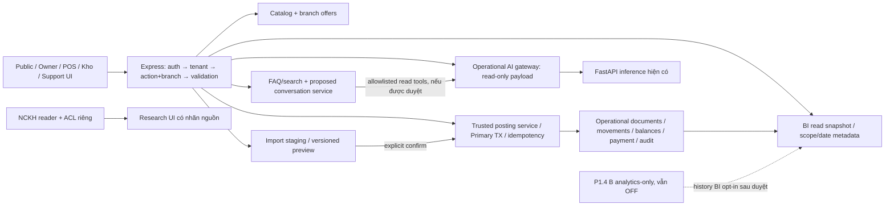

# Retail Insight B0 — Nghiệp vụ và kiến trúc
07/11/2026. **THIẾT KẾ ĐỀ XUẤT, CHƯA TRIỂN KHAI.** Đọc cùng [alignment](RETAIL_INSIGHT_B0_UI0_ALIGNMENT.md), [data model](RETAIL_INSIGHT_B0_DATA_MODEL.md), [API](RETAIL_INSIGHT_B0_API_CONTRACTS.md), [quyền/CRUD](RETAIL_INSIGHT_B0_PERMISSIONS_CRUD.md), [test/lộ trình](RETAIL_INSIGHT_B0_TEST_AND_ROADMAP.md).

## Bằng chứng và hiện trạng
VERIFIED_IN_SOURCE nghĩa là có đường mã được mount và có implementation, **không chứng nhận production-ready**. PARTIAL là chỉ có một phần yêu cầu; MOCK/DEMO là mã mẫu; MISSING là không thấy implementation trong phạm vi source; UNKNOWN là cần runtime/native/đầu vào thật. Một module có thể có cả implementation VERIFIED và readiness UNKNOWN.

| ID | Yêu cầu | Bằng chứng source | Kết luận / tái sử dụng / tác động |
|---|---|---|---|
| F01 | Đăng ký OWNER một mình | routes/auth.js register transaction tạo org/user/branch/assignment; không login tự động | VERIFIED_IN_SOURCE; giữ flow201→login; default_branch_id và onboarding progress MISSING |
| F02 | Tenant/branch isolation | middlewares/auth.js authenticate+tenantScope; common.js branchClause/assertBranch; FK001/002 | VERIFIED_IN_SOURCE predicates/ACL; concurrency/security native UNKNOWN; tiếp tục backend enforcement |
| F03 | Nhân sự/chi nhánh | catalog.js + operations/Management.jsx POST/PUT branch, GET/POST/PATCH staff | PARTIAL: không archive/reactivate branch, staff invitation/audit/profile edit thiếu; OWNER không cần tạo staff |
| F04 | Product chung/branch price | products.sale_price/status tại002; tồn theo org/branch/product | PARTIAL: danh mục chung và stock riêng có; giá/trạng thái theo branch/barcode/unit/supplier thiếu; cần expand model, P1.4 pricing review |
| F05 | Import | product-import.js, operations/ProductImport.jsx | PARTIAL: CSV fixed headers,1–200row,60KB, thêm mới catalog, preview hash file; XLSX/mapping/staging/resume/opening/receipt import MISSING |
| F06 | Bán/nhập | ledger.js postDocument | VERIFIED_IN_SOURCE transaction, sorted product locks, balance locks, UNIQUE key/hash; POS đầy đủ PARTIAL, payment/shift/refund/cost/audit runtime MISSING |
| F07 | BI | bi.js readSnapshot + calendarAggregate; operations/Dashboard.jsx | VERIFIED_IN_SOURCE revenue/orders/units/trend/branch/category/stock; valuation và profit null; không gọi đó là lợi nhuận |
| F08 | AI | business/ai.js→FastAPI main.py/features/models/algorithms | PARTIAL operational inference path; no chatbot endpoint/KB/conversations; readiness UNKNOWN, default models folder chỉ README |
| F09 | Research | ai.js research grants + db/research.js reader + operations/Research.jsx | VERIFIED_IN_SOURCE tách dataset quyền riêng; không query DB/research data trong B0 |
| F10 | Demo | pages/{Forecast,Products,Inventory,Replenishment,Reports,ResearchDashboard,...}, mockData.js | MOCK/DEMO, không là màn hình operations đang mount; assistant hiện ComingSoon, demoAnswer không inference |
| F11 | P1.4 | app.js không import p14; RC2 candidate state/digest | Thiết kế/source cô lập, không active. TODAY_ONLY/date/period/receipt/fence chưa phải runtime. Native NO-GO giữ nguyên |
| F12 | Support/platform | không route/backend ticket/admin support trong app | MISSING; ADMIN có ở label/allowlist frontend nhưng không trong ENUM users; không tự cấp PLATFORM_ADMIN |

Các nhận định định vị bằng [source inventory](RETAIL_INSIGHT_B0_UI0_SOURCE_INVENTORY.md), gồm route graph và anchor hàm. Không dùng các con số PASS ở lượt cũ làm kết quả B0.

## Năm kịch bản cùng một mô hình dữ liệu
1. OWNER một cửa hàng: register tạo một branch; login vào overview và CTA Thêm sản phẩm → nhận tồn → bán. Branch được chọn tự động khi chỉ có một branch ACTIVE được phép; form vẫn hiển thị tên. Không ép ca/nhân viên/chi nhánh thứ hai như bước onboarding giả hiện đã có.
2. OWNER có staff: invite/create staff chỉ khi muốn; assignment nhiều branch; OWNER vẫn làm CASHIER/INVENTORY bằng permission, không cần account phụ.
3. OWNER nhiều branch: tổ chức chung, catalog một SKU duy nhất; switch All chỉ dành report, giao dịch luôn một branch cụ thể. Rời branch khi cart/draft chưa lưu phải xác nhận; không mang giá branch A sang B.
4. Nhiều vai trò: action grants theo branch; hiện user.role đơn + role mỗi assignment chưa phải permission engine/multi-role thực. Default-deny; owner override chỉ trong org và không vượt period/policy.
5. Nhiều org: user/session hiện gắn một org; chưa có membership/switch org. Thiết kế ban đầu giữ một OWNER/org như hiện trạng; mở nhiều org/user cần contract riêng. Không tạo database/schema theo kích cỡ cửa hàng.

## Kiến trúc đích (không triển khai)

Mục tiêu nhiều Backend trên một MySQL Primary: không mutex RAM làm trọng tài; transaction/UNIQUE/row locks + authorization recheck ở server. LB/replicas/Redis/AI queue chỉ là dependency tương lai, không có trong bàn giao này. Readiness/inventory production UNKNOWN.

## Import Studio — 3 ý định vận hành và 1 ranh giới lịch sử
Catalog import: không stock/revenue; có preview diff create/update, update cần product.update, không ghi đè ngầm. Opening stock: chỉ init scope được duyệt, natural opening identity org/branch/product/opening_epoch; quantity đã có movement không được “nhập lại tồn đầu”; dùng adjustment có phê duyệt. Receipt import: chọn branch/supplier, tạo draft receipt rồi confirm tăng stock **một lần**, không xem upload là nhận hàng.
Historical archive P1.4 B là luồng khác, analytics-only; không dùng receipts runtime để hồi tố kho, không cho AI ăn archive hoặc research.

Flow: upload quarantine → sheet/header selection → mapping suggestions/confidence → normalize/validate → match existing/new product proposal → staging grid → immutable preview → permission/period/stock recheck → atomic commit receipt/result. Lưu drafts org/user scope, autosave If-Match, conflict409 không last-write-wins; khả năng resume thực cần backend staging mới. File lớn dùng approved sub-batch manifest, hiển thị PARTIALLY_COMMITTED + từng chunk, không quảng cáo atomic file. Phase đầu khuyến nghị atomic bounded batch; chốt limit sau native benchmark.
CSV parser hiện có tái sử dụng canonical quoting/BOM/decimal validation, không tái dùng preview_hash(file) như full authorization token. Preview mới gồm source/mapping/schema/content/revision/tenant/branch/mode/expiry; fingerprint của file không thay identity chứng từ.
Không tự tạo DB columns từ header, không đoán SKU/locale/units thấp confidence. Quarantine formula/macro/ZIP bomb/CSV formula export; text lỗi không thực thi HTML. New catalog proposals lưu staging đến commit, không tự cấp quyền create cho INVENTORY.

## POS, payment, shift và đảo giao dịch
Tách cart DRAFT → document POSTED bất biến; payment PENDING/CONFIRMED/FAILED/UNKNOWN có timeline độc lập. Quyết định phase đầu: cash hoặc bank được nhân viên có quyền xác nhận thủ công, mặc định không giữ stock cho payment pending; sale+payment confirmation+stock+cost snapshot+audit commit chung khi xác nhận đủ điều kiện. QR chỉ chỉ dẫn, không chứng minh tiền đã tới. Gateway async sau này cần reservation/expiry/reconciliation contract riêng.
Cùng request_key là cùng intent/envelope; giá server và qty/tổng kho khóa lại khi confirm. Giữ legacy normalizer và key semantics. Conflict về giá cần reprice+người dùng review, không tự phát intent mới sau UNKNOWN.
Sửa cart/void trước posting không economic delta. Sau posting không DELETE: refund/return linked original line, giới hạn cumulative returned_qty bằng row lock; tiền hoàn và stock disposition SELLABLE/DAMAGED/NOT_RETURNED tách biệt. Sai chứng từ cần reversal/correction có lý do/approval, không UPDATE header cũ.
Shift OPEN/CLOSING/CLOSED: owner tự mở, opening cash không là doanh thu; expected_cash = opening + cash sales − confirmed cash refunds + controlled cash adjustments. Bank confirmations tổng riêng, counted_cash/variance + reason, unique active shift theo quy tắc register/branch/user được duyệt. Ca không là business period và không tự mở kỳ.
Không thêm VAT/discount/lợi nhuận giả vào UI hiện tại: future discount snapshot line-level và rounding contract cần duyệt; invoice hiện INTERNAL_SALES_RECEIPT, không phải hóa đơn thuế.

## Kho và giá vốn
Stock hiện tại chỉ balance quantity, không reserved/available. Đích on_hand−reserved=available; nếu chưa reservation, ghi rõ available hiện bằng on_hand, dữ liệu hiển thị không giữ chỗ.
Stock count: DRAFT → COUNTING → REVIEW → APPROVED → POSTED. Lưu baseline revision/cutoff và movement delta trong lúc đếm; chốt rebase chênh lệch hoặc freeze ngắn được duyệt, không lấy expected_qty cũ trừ trực tiếp stock mới. Adjustment delta có approval, reason, Primary TX + period gate.
Transfer: DRAFT → APPROVED → DISPATCHED → PARTIALLY_RECEIVED → RECEIVED; source trừ khi dispatch, in_transit giữ sổ riêng; target chỉ cộng số nhận xác nhận. Tổn thất/partial/cancel có linked discrepancy/reversal, không tự phục hồi cả hai bên. Khóa branch IDs tăng dần rồi SKU IDs; không giữ TX xuyên vận chuyển; UNIQUE từng dispatch/receive intent và tổng received≤dispatched.
Đề xuất moving weighted average **theo branch/product** phù hợp scope nhỏ; không duyệt ở B0. Receipt unit_cost ≠ product.cost_price tham khảo. Trước sale khóa cost state, ghi cost_unit_snapshot/total_cost/valuation_version trên line, thiếu cost → UNKNOWN gross margin, không0. Receipt mới không đổi COGS hóa đơn cũ; return restock theo cost gốc; transfer mang cost snapshot source vào destination weighted average. Opening valuation/discount/fees/tax/allocation và decimal rounding phải chốt trước implementation. Không tính “profit” từ sale_price−catalog.cost_price của hôm nay.

## Support và cài đặt
Ticket tenant-scoped, customer-visible status, correlation ID, export logs redacted; không tự cho nhân viên support đọc sales. PLATFORM_ADMIN identity plane riêng, support access grant theo mục đích/thời hạn/audit nếu có phê duyệt; mặc định chỉ service/tenant status và ticket được chia sẻ.
Yêu cầu website bán hàng online riêng là ticket tư vấn opt-in, ngoài NCKH, không marketplace hay quyền bán online cho tất cả role.
Store profile/logo/currency/configurable timezone là đề xuất. Runtime BI đang IANA Asia/Ho_Chi_Minh, AI UTC; thay timezone/currency không phải UI toggle đơn giản, cần policy version/conversion/history design và approval. Chưa có endpoint đổi org settings.

## Xung đột cần duyệt
A. Thu hẹp MANAGER khỏi global catalog mutation hay cấp explicit org-level product.manage? Hiện source cho OWNER/MANAGER.
B. Branch offers v1: copy giá mặc định chỉ khi snapshot/policy, null override nghĩa inherit; không duplicate product, không đổi AI input âm thầm.
C. Opening-stock identity, đơn vị integer hiện tại (chưa kg/fractional qty), barcode uniqueness và nhiều mã/quy đổi unit.
D. Cash/bank manual confirm, shift bắt buộc hay optional cho owner; refund authority và damaged-stock semantics.
E. Weighted-average valuation và rounding; stock count freeze/rebase; transfer partial/loss policy.
F. P1.4 activation là track riêng có native approval; B1 không được coi là quyền activate RC2.
G. Roles action permissions/platform admin/support access; retention drafts/tickets/audits và AI external processing.
Mỗi quyết định có acceptance và phase tại test/lộ trình; chỉ duyệt hướng B0 không cho phép migration hay code B1.
