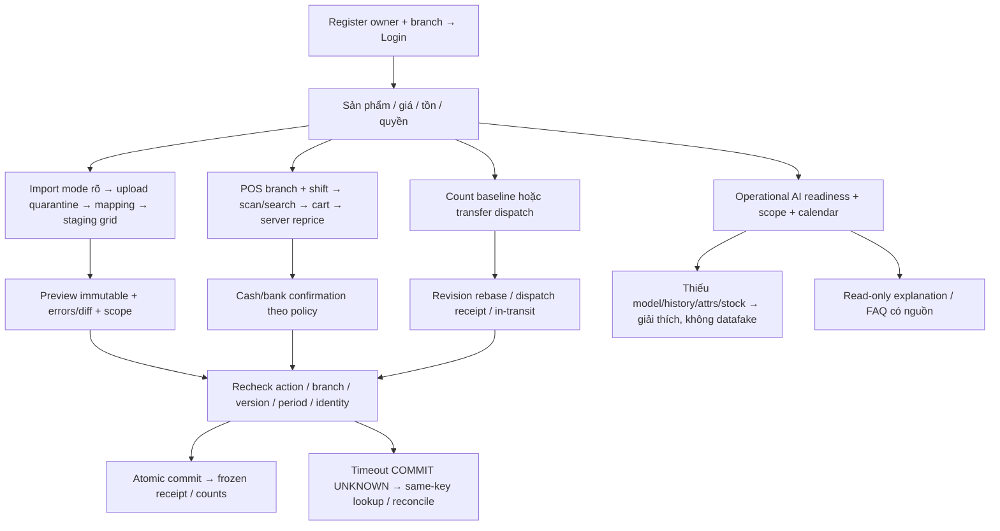
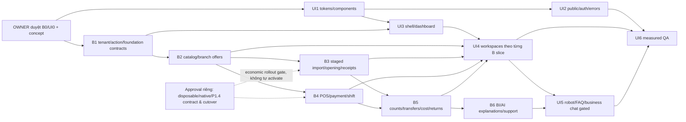

# Retail Insight — B0 + UI0 alignment
07/11/2026. **Khảo sát và thiết kế, CHƯA TRIỂN KHAI. Dừng chờ duyệt B1/UI1.**

## Cách đọc bộ bàn giao
- [B0 nghiệp vụ/kiến trúc](RETAIL_INSIGHT_B0_SYSTEM_DESIGN.md), [ERD/data dictionary](RETAIL_INSIGHT_B0_DATA_MODEL.md), [permissions/CRUD](RETAIL_INSIGHT_B0_PERMISSIONS_CRUD.md), [API contracts](RETAIL_INSIGHT_B0_API_CONTRACTS.md), [test/B1–B6](RETAIL_INSIGHT_B0_TEST_AND_ROADMAP.md).
- Tám UI0: [audit](FRONTEND_UI_AUDIT.md), [design system](RETAIL_INSIGHT_DESIGN_SYSTEM.md), [page matrix](PAGE_REDESIGN_MATRIX.md), [robot](ROBOT_AI_ASSISTANT_SPEC.md), [chatbot](CHATBOT_ARCHITECTURE.md), [error/support](ERROR_AND_SUPPORT_UX.md), [motion/performance](MOTION_AND_PERFORMANCE_BUDGET.md), [UI roadmap](UI_IMPLEMENTATION_ROADMAP.md).
- [Source inventory và anchor](RETAIL_INSIGHT_B0_UI0_SOURCE_INVENTORY.md), [coverage đặc tả](RETAIL_INSIGHT_B0_UI0_REQUIREMENT_COVERAGE.md), [concept A/B/C](b0_ui0/CONCEPTS.svg), [robot8states](b0_ui0/ROBOT_STATES.svg), [manifest](RETAIL_INSIGHT_B0_UI0_MANIFEST_2026-11-07.md).

## Kết luận từ source, không tuyên bố runtime
VERIFIED_IN_SOURCE: auth/session/tenant predicates, register tạo owner+branch, catalog subset, staff/branch management subset, SALE/RECEIPT posting transaction với key/hash/stock locks, BI scoped read snapshots/calendar, AI gateway và research ACL có implementation được mount.
PARTIAL: POS chỉ form ledger, CSV import chỉ danh mục, branch/staff CRUD thiếu archive/invite/audit, không branch price, AI inference có các điều kiện thiếu dữ liệu/artifact/snapshot. Source implementation không bằng production-ready.
MOCK/DEMO: legacy pages/mockData/demoAnswer/local ProductEntry không phải active operational workspaces; assistant active còn ComingSoon.
MISSING: payment/shift/return/count/transfer/supplier/branchoffers/stagingresume/chatKB/conversation/tickets/platform identity plane thực.
UNKNOWN: DB/schema/grants đang vận hành, model availability từ env khác, real latency/capacity/concurrency/AA/WebVitals, data coverage. Không kết nối DB hoặc chạy app để xác nhận. Default models folder chỉ thấy README không chứng minh mọi deployment thiếu model.
P1.4 RC2 giữ CANDIDATE_NOT_EXECUTABLE/nativeVerified=false; B0 không đổi state, không mountp14, không triển khai B1/UI1.

## Source inventory tóm tắt và tác động đề xuất
| Flow | Nguồn chính | Reuse / cần mới | DB / TX / priority / proof |
|---|---|---|---|
| Owner onboarding | auth routes + Account + Dashboard | reuse register, mới progress/defaultbranch | expand đề xuất; register TX giữ; P1,T01–03 |
| Role/navigation | middleware/common + AuthContext/Sidebar | reuse session, mới capabilities/action grants | schema quyền có thể mới; recheck lock protocol; P0,T04–05/T20 |
| Catalog/branch price | catalog.js + Products.jsx | reuse globalSKU, mới offers/barcodes/supplier | new scoped FK/versions; pricing locks; P0,T06/T09 |
| Import Studio | product-import.js + ProductImport.jsx | parserreuse; staging/mapping/resume/commit mới | new staging/receipt; atomic effects/P1.4 gates; P0,T07–14 |
| POS/payment/shift | ledger.js + Ledger.jsx | reuse serverstock/price/internalinvoice; payment/shift/lookup mới | new ledgers/snapshots; no network inTX; P0,T15–18 |
| Kho count/transfer/refund | inventory queries + nativeP14design | new state machine/cost/reversals | multi-branch locks/period/receipt; P1,T22–24/T29 |
| BI/research/AI | bi.js/ai.js/FastAPI + Dashboard/AI/Research | preserve calendars/read scope/research separation | snapshots/explanation tables future; no pipelinechange; P1,T21/T25–27 |
| Help/platform | ComingSoon/demoAnswer only | mới curatedKB/ticket/read-only chat/operatorplane | new ACL/retention; không economic mutation; P1/P2,T27/T35 |
| Visual system/errors | global.css/Elements/layout | reuse stack/primitives, tokens/components mới | không DB, nhưng không fake pending/permissions; P0/P1,T31–32 |

## Business-to-UI traceability
Bảng giống canonical PAGE_REDESIGN_MATRIX, tạo từ cùng50hàng để đối chiếu. State/responsive/accessibility codes được định nghĩa đầy đủ ở [page matrix](PAGE_REDESIGN_MATRIX.md); không bỏ loading/empty/error/success hay keyboard/mobile vì chỉ ghi UI summary.
| ID | Business flow | Actor/quyền | Route hiện có | API hiện có | Data source | Trạng thái | UI đề xuất | E/L/Error/Success | Responsive/A11y | Priority | Dependency | Acceptance |
|---|---|---|---|---|---|---|---|---|---|---|---|---|
| P01 | Landing công khai | Public | Chưa có; / đang protected | Không | Không | MISSING | /welcome cinematic, preview có nhãn | SINFO | R1/A1 | P1 | UI2 | Landing không fake số/khách hàng; root bookmark giữ |
| P02 | Đăng nhập | All | /login | POST auth/login; GET auth/me | users/auth_sessions | VERIFIED_IN_SOURCE | Auth form DS + status typed | SFORM | R1/A1 | P0 | UI1/2 | 401 không leak email; keyboard submit |
| P03 | Đăng ký org+branch | Public | /register | POST auth/register | org/user/branch/assignment | VERIFIED_IN_SOURCE | Owner1branch, 201→login | SFORM | R1/A1 | P0 | UI2+B1 | Không ép staff hoặc tự login |
| P04 | Khôi phục mật khẩu | Public | /forgot-password | POST auth/forgot-password→503 | Email delivery chưa có | PARTIAL | Unavailable rõ, contact config | SINFO | R1/A1 | P1 | UI2+email | Không báo đã gửi email giả |
| P05 | Onboarding | OWNER | Chưa có | Chỉ register/me hiện có | Org/branch; progress thiếu | PARTIAL | Checklist progressive optionalstaff | SONBOARD | R1/A1 | P1 | B1/UI2 | Không yêu cầu thêm OWNER/cashier account |
| P06 | Dashboard org/branch | O/M; staff greeting | / | GET bi/overview; dashboard/overview | docs/items/balances | VERIFIED_IN_SOURCE | KPI source/as_of, null≠0, quickactions | SREAD | R2/A2 | P0 | UI3/P1.3 | Scope và date/stock labels không đổi |
| P07 | Reports BI | O/M | /reports→Dashboard | GET bi/overview | Read snapshot | PARTIAL | Dedicated reports; export gated | SREAD | R2/A2 | P1 | UI4+B6 | Không gọi revenue thành profit hoặc reportfreeze |
| P08 | Catalog list/detail | All view; O/M edit hiện tại | /products | GET/POST/PUT products | products/categories | PARTIAL | List+detail+archive rõ context | SREAD | R2/A2 | P0 | B2/UI4 | MANAGER org mutation policy duyệt; no stock edit |
| P09 | Product create/edit | O/M; /new chỉO hiện tại | /products/new→Products | POST/PUT products | Shared catalog | PARTIAL | Guided typed fields, no fakeAI attrs | SFORM | R1/A1 | P0 | B2/UI4 | Invalid JSON không mất form; no duplicateSKU |
| P10 | Danh mục | O/M hiện tại | Embedded /products | GET/POST categories | categories | PARTIAL | CRUD+referenced archive state | SFORM | R2/A2 | P1 | B2/UI4 | Referenced category không cascade delete |
| P11 | Import CSV hiện tại | O/M | Embedded /products | POST products/import | Create-only products | PARTIAL | Giữ CSV flow, không nhãn nhận hàng | SIMPORT | R2/A3 | P0 | UI4 | 200row/60KB; preview khôngstock |
| P12 | Import Studio | Mode/action scoped | Chưa có | Staging/mapping/session APIs thiếu | Staging đề xuất | MISSING | Sheet/mapping/grid/autosave/resume | SIMPORT | R3/A3 | P0 | B3/UI4/P1.4 gate | Rời trang/resume không mất draft; commit onlyonce |
| P13 | Opening stock | O + explicit approver | Chưa có | Opening confirm thiếu | Opening identity/posted docs đề xuất | MISSING | Init stock khác receipt/history | SPOST | R2/A1 | P0 | B3/B5/P1.4 | Repeat opening không cộng lặp |
| P14 | Giá/sellability branch | O; M delegated | Chưa có | Branch offers API thiếu | branch_products thiếu | MISSING | Price inheritance/override/version diff | SFORM | R2/A2 | P0 | B2/UI4 | MộtSKU 35k/37k, stockA/B độc lập |
| P15 | Tồn kho live | All authenticated hiện tại | /inventory | GET inventory | inventory_balances | VERIFIED_IN_SOURCE | Stock-current table + scoped actions | SREAD | R2/A2 | P0 | UI4/P1.3 | Ngày lọc không giả tồn hồi tố |
| P16 | Movement history | Assigned scope | /inventory | GET inventory/movements | movement+document time | VERIFIED_IN_SOURCE | Timeline/read filters | SREAD | R2/A2 | P0 | UI4/P1.3 | Giữ raw audit vs doc-time distinction |
| P17 | Nhập hàng thủ công | O/M/I | /inventory form | POST receipts | RECEIPT document TX | PARTIAL | Receipt draft/review, supplier extension | SPOST | R2/A1 | P0 | B3/UI4/P1.4 | Confirmed delta1lần; sourceprice snapshot |
| P18 | Receipt list/detail/in | O/M/I | /inventory | GET receipts,receipts/:id | Header/items | VERIFIED_IN_SOURCE | Drawer detail/print, preservehistory | SREAD | R2/A2 | P0 | UI4 | Không destructive edit posted |
| P19 | Bán hàng form hiện tại | O/M/C | /sales | POST sales | SALE/items/movements | PARTIAL | Không gọi confirmed payment khi chỉ SALE | SPOST | R2/A1 | P0 | UI4/B4/P1.4 | Server price/stock/key giữ semantics |
| P20 | POS search/scan/cart | O/M/C | Chưa /pos; /sales chỉform | Catalog+sale có; barcode API thiếu | Branch catalog đề xuất | PARTIAL | /pos splitcart, keyboard/scan | SPOS | R4/A4 | P0 | B2+B4/UI4 | LastSKU race; no robot overlay/payment giả |
| P21 | Invoice history/detail | O/M/C | /sales | GET sales,sales/:id | Snapshotitems/total | VERIFIED_IN_SOURCE | List/detail/internalreceipt print | SREAD | R2/A2 | P0 | UI4 | Chứng từ nội bộ không giả e-invoice thuế |
| P22 | Cash/bank payment | sale/payment action | Chưa có | Payment API thiếu | Payment ledger thiếu | MISSING | Pending/confirmed/unknown timeline | SPOS | R4/A4 | P0 | B4/UI4 | QR≠received; unknown reconcile sameintent |
| P23 | Ca thu ngân | O/M/C theo action | Chưa có | Shift API thiếu | cashier_shifts thiếu | MISSING | Open/close/variance/reconcile | SPOST | R2/A1 | P1 | B4/UI4 | Owner tựmở; expectedcash không lẫnbank |
| P24 | Return/refund | Requester+approver | Chưa có | Return/refund API thiếu | Linked original lines đề xuất | MISSING | Qty bound/reason/disposition | SPOST | R2/A1 | P1 | B4/B5/UI4 | Không DELETEsale; partialreturn không vượtqty |
| P25 | Kiểm kê/adjust | O/M approve; I count | Chưa có | Count API thiếu | Count baseline+revision thiếu | MISSING | Count/rebase/diff approve | SPOST | R3/A3 | P1 | B5/UI4/P1.4 | Stock đổi giữa đếm/confirm phải stale/rebase |
| P26 | Chuyển kho | Source/dest scoped | Chưa có | Transfer API thiếu | In-transit ledger thiếu | MISSING | Dispatch/partialreceive/loss | SPOST | R2/A1 | P1 | B5/UI4/P1.4 | Đích chưa nhận không tăng stock |
| P27 | Nhà cung cấp | O/delegated | Chưa có | Supplier API thiếu | Supplier thiếu | MISSING | List/detail/create/archive | SFORM | R2/A2 | P1 | B2/B3/UI4 | Referenced supplier archive, notcascade |
| P28 | Chi nhánh | OWNER; assigned view | /branches | GET/POST/PUT branches | branches | PARTIAL | Default/status/archive/reactivate | SFORM | R2/A2 | P0 | B1/UI4 | Có giao dịch/stock phải giải thích cannotdelete |
| P29 | Nhân viên | OWNER | /users | GET/POST/PATCH staff | users/user_branch_roles | PARTIAL | Assignments/disable/invite/history | SFORM | R2/A2 | P0 | B1/UI4 | Disable giữ invoice actor; revoke race gate |
| P30 | Tài khoản/cửa hàng | /settings O-only hiện tại | /settings→Account | GET me,dashboard/overview | Session/org read | PARTIAL | Common /account; owner settings separate | SFORM | R1/A1 | P1 | B1/UI3 | Không UI timezone toggle đổi calendar ngầm |
| P31 | SKU forecast | O/M scoped | /forecast | GET ai/forecast?task=sku,readiness | Livehistory/model | PARTIAL | Readiness/history/attrs/model panel | SAI | R2/A2 | P1 | B6/UI4 | No fake accuracy;6month/attrs checks |
| P32 | Total forecast | O/M scoped | /forecast/total | GET ai/forecast?task=total | Prior forecast snapshot thiếu | PARTIAL | Missing snapshot explicit | SAI | R2/A2 | P1 | B6/UI4 | Không reconstruct causal forecast bằng attrs hômnay |
| P33 | Multi forecast | O/M scoped | /forecast/multi | GET ai/forecast?task=multi | Live history12months | PARTIAL | Origin/horizon/source chart | SAI | R2/A2 | P1 | B6/UI4 | Cold-start không pad trướcorgexistence |
| P34 | Stockout alerts | O/M scoped | /alerts | GET ai/forecast?task=stockout | Model7features proxy | PARTIAL | Proxy risk label + missing stock | SAI | R2/A2 | P1 | B6/UI4 | Không xemscore như calibrated guarantee |
| P35 | Replenishment | O/M scoped | /replenishment | GET ai/forecast?task=replenishment | Knownstock+forecast | PARTIAL | Explainformula, review action link | SAI | R2/A2 | P1 | B6/UI4 | ceil(pred)+ceil(.2pred); no autoPO/stockdelta |
| P36 | AI summary | O/M | Embedded dashboard | GET ai/summary | Five forecasttasks | PARTIAL | Lazy/intentional AI status summary | SAI | R2/A2 | P1 | B6/UI3 | Show null, not0; no repeatedfanout dueanimation |
| P37 | Research library | O/M+datasetgrant | /research | research datasets/runs/forecasts | NCKH archive riêng | VERIFIED_IN_SOURCE | Researchlabel+grantedselector | SREAD | R2/A2 | P1 | UI4 | Không feedlive/AI bằngNCKHfallback |
| P38 | Research aliases | Authenticated then targetguard | /research-demo,/research-branches | Redirect /research | No extra data | VERIFIED_IN_SOURCE | Giữ bookmark redirects | SINFO | R1/A1 | P2 | UI3 | Không route sang old mock thànhlive |
| P39 | Robot/chat assistant | Help; business O/M scoped | /assistant→ComingSoon | Chat/KB/storage API thiếu | Legacy demoAnswer RAM | PARTIAL; legacy MOCK/DEMO | FAQ thật trước business chat | SHELP | R5/A5 | P1 | B6/UI5 | No fake answer/no write tools/no crossscope |
| P40 | Market/service request | O opt-in; proposed | /market→ComingSoon | Market API không có | Legacy pricecalculator demo | PARTIAL | Gated service request ngoàiNCKH | SINFO | R1/A1 | P2 | B6/UI2/5 | Không bịa giá thịtrường/vendor/phone |
| P41 | Support Center | Own ticket/org policy | Chưa có | Ticket/help API thiếu | Ticket/KB đềxuất | MISSING | FAQ/search/ticket/handoff | SHELP | R5/A5 | P1 | B6/UI2/5 | Chưa201 không báo ticket sent |
| P42 | Platform admin | Separate identity | Chưa có | Platform API thiếu | users ENUM khôngADMIN | MISSING | Service shell không tenant data | SREAD | R2/A2 | P2 | B1/B6/UI3 | No blanket cross-tenant business access |
| P43 | Legacy pages | Không mounted | pages/* trừ auth3pages | Một số oldAPI; còn lại mock | mockData/local state | MOCK/DEMO | Importgraph review trước retire | SINFO | R2/A2 | P2 | UI1/6 | Không dùng demo làm runtime proof |
| P44 | Error 401 | Auth/scope appropriate | Chưa dedicated route | auth-expired | No sensitive data | PARTIAL | Dedicated safe recovery 401 | SERROR | R1/A1 | P0 | UI2/3 | Retry read only; writes UNKNOWN→lookup |
| P45 | Error 403 | Auth/scope appropriate | /forbidden | Generic State/error hiện tại | No sensitive data | PARTIAL | Dedicated safe recovery 403 | SERROR | R1/A1 | P0 | UI2/3 | Retry read only; writes UNKNOWN→lookup |
| P46 | Error 404 | Auth/scope appropriate | Chưa dedicated route | Wildcard Navigate(/) | No sensitive data | PARTIAL | Dedicated safe recovery 404 | SERROR | R1/A1 | P0 | UI2/3 | Retry read only; writes UNKNOWN→lookup |
| P47 | Error 500 | Auth/scope appropriate | Chưa dedicated route | Generic State/error hiện tại | No sensitive data | PARTIAL | Dedicated safe recovery 500 | SERROR | R1/A1 | P0 | UI2/3 | Retry read only; writes UNKNOWN→lookup |
| P48 | Error 503 | Auth/scope appropriate | Chưa dedicated route | Generic State/error hiện tại | No sensitive data | PARTIAL | Dedicated safe recovery 503 | SERROR | R1/A1 | P0 | UI2/3 | Retry read only; writes UNKNOWN→lookup |
| P49 | Error offline | Auth/scope appropriate | Chưa dedicated route | Generic State/error hiện tại | No sensitive data | PARTIAL | Dedicated safe recovery offline | SERROR | R1/A1 | P0 | UI2/3 | Retry read only; writes UNKNOWN→lookup |
| P50 | Error maintenance | Auth/scope appropriate | Chưa dedicated route | Generic State/error hiện tại | No sensitive data | PARTIAL | Dedicated safe recovery maintenance | SERROR | R1/A1 | P0 | UI2/3 | Retry read only; writes UNKNOWN→lookup |

## Role/navigation và năm kịch bản
Owner một mình: dashboard + POS + catalog + nhập/kho + reports + AI + branch/staff/settings/help; không ép staff/branchthứhai. Owner cóstaff giữ POS/receive quyền của mình. Multi-branch All chỉ report, posting luôn oneexplicitbranch; draft/cart đổi scope phải review.
Manager chỉ assigned branches và explicit globalcatalog delegation đề xuất; source hiện khác, cần duyệt. Cashier POS-first/invoices/shift/account/help. Inventory kho/receipts/import/count/transfer đúng action, không catalog commit tự có vì là “nhân viên kho”. Backend enforcement giữ trên direct API, list/count/detail/replay/export/chat.
Nhiều org độc lập: session tổ chức hiện tại, không orgswitch fake, không shared cache key chỉ URL/role/productID. Platform plane chưa có, không convert frontend ADMIN label thành roottenant quyền.

## UX flows có business state/guard

Không xóa chứng từ hoàn tất qua UI đẹp; biến động mới là linked reversal. Upload≠postedstock, SALE≠paymentconfirmed, forecast≠purchaseorder, QR≠fundsreceived, robotThinking≠LLM/backend sẵn sàng.

## Concept và chatbot readiness
Khuyến nghị **C Hybrid**: /welcome cinematic có robot nguyên bản; dashboard theo enterprise light/dark; POS quiet, không glow/3D/chat overlay. A darkbrand mạnh nhưng tables/POS khó hơn; B dễ chuyển từ hiện trạng nhưng landing ít bản sắc. Giữ / dashboard đã auth và các bookmarks, không tự chuyển root thành landing khi chưa duyệt.
Concept và8robotstates là SVG thiết kế tĩnh, không asset runtime. Dùng placeholder “—/chưa có dữ liệu”, không lấy số liệu/testemail trong screenshot cũ làm productdemonstration.
Chatbot chưa có backend thực: FAQ/search có thể làm sau UI5/B6 với tài liệu thật; Business AI chỉ explanations read-only của API được phép, không sinh SQL hoặc thao tác kinh tế. Không inference hoặc externalprovider trong lượt này. Model forecast hiện có không phải LLMchat.

## Dependency graph B1–B6 × UI1–UI6

B6 FAQ/support có thể song song sớm theo scope riêng; arrow không bắt chờ AI mới ship POS. UI4 không là một rewrite lớn; mỗi module cần backend contract/economic proof tương ứng. UI1/2 appearance có thể ship độc lập sau approval, không ngầm migrate DB.

## OWNER cần phê duyệt (chưa hỏi thông tin bí mật)
1. Concept C và landing mới /welcome, giữ / dashboard; default light/dark/system, robot tĩnh trước animation/3D.
2. MANAGER có orgcatalog delegation không, hay thu hẹp branch-only? Capabilities và action quyền, multi-role model; PLATFORM_ADMIN tách riêng.
3. Branch price inheritance, enabled flag, barcode normalization/unit integer v1; AI listing_price không tự đổi semantics.
4. Ba live import modes + archivehistory riêng, atomic batch v1/limits/retention/sourceidentity, ai được tạocatalog/commit/opening/selfapprove.
5. Cost/attributes field-level visibility: GETproducts hiện trả p.*; UI không hiển thị không phải privacy boundary. Cash/bank manual confirmation, QRlabel, shift bắt buộc hay optional choOWNER, tiền đã nhận nhưngstock fail/reconciliation policy.
6. Discount/tax/rounding, WAC branchcost, missing-cost display, historical COGS và return disposition/refund approval.
7. Stockcount freeze/rebase và transfer partial/intransit/loss, period-closed handling; no delete posted.
8. Store profile/defaultbranch và timezone/currency change scope; không coi là cosmetic settings.
9. Report linefilters/full-document totals/datebasis/as_of; source tags research/archive/live, causal forecast snapshots/cold-start.
10. FAQ corpus, support contacts thật, ticket privacy/retention/operator access; externalLLM provider/data sharing/cost nếu cần, no mutationtools.
11. Budget/performance/a11y devices và môi trường test riêng; B1/UI1 implementation approval tách nativeP1.4 activation.
12. Repair tài liệu PREP mất dấu là gói riêng có diff/manifest, không sửa historical artifacts để che lịch sử.

## GO / NO-GO và bằng chứng
GO: review docs, choose concept, resolve business decisions. NO-GO: code/appstart/packageinstall/DB queries/migration/seed/native execution/P1.4activation/B1/UI1/infra/weights/research modifications.
Bằng chứng offline củaB0: source/hash inventory + route/API static crosswalk, nineopaquecontrast calculations, SVG/XML/docslink/UTF8 integrity checks; **không chạy lại370tests cũ** và không gọi đó là B0PASS/nativeevidence. Runtime screenshots/Lighthouse/AA/inference/concurrency remain UNKNOWN/BLOCKED.
Dữ liệu trong visual boards là placeholders; reference webpages được truy cập, ảnhGlobalCode/article404 gốc chỉ có mô tả; chỉ xem PNG test lịch sử trongrepo.
**DỪNG tại B0 + UI0. Chờ OWNER xem thiết kế và duyệt scope/concept trước viết code.**
